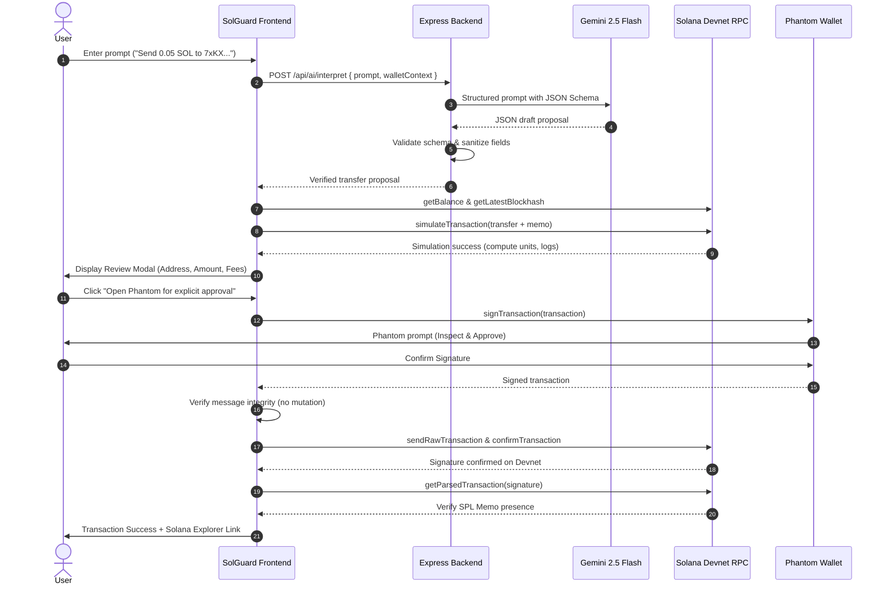

# SolGuard AI

**Natural-Language Copilot & Security-Oriented Transaction Engine for Solana.**

[](https://nodejs.org/)
[](https://solana.com/)
[](https://expressjs.com/)
[](https://vitejs.dev/)
[](https://tailwindcss.com/)
[](tests/)
[]()

---

> *"Gemini proposes. SolGuard verifies. Phantom authorizes. Solana executes."*  
> — **Core Architectural Principle**

SolGuard AI bridges the gap between natural-language user intent and on-chain blockchain execution. By decoupling non-deterministic AI interpretation from deterministic schema validation and user-authorized wallet signing, SolGuard ensures that generative models never hold keys, sign payloads, or execute transactions autonomously.

---

## Table of Contents

- [What is SolGuard AI?](#what-is-solguard-ai)
- [The Problem](#the-problem)
- [Our Approach: 4-Stage Security Boundary](#our-approach-4-stage-security-boundary)
- [Feature Matrix](#feature-matrix)
- [How SolGuard AI Works](#how-solguard-ai-works)
- [System Architecture](#system-architecture)
- [Technology Stack](#technology-stack)
- [Getting Started](#getting-started)
  - [Prerequisites](#prerequisites)
  - [Installation](#installation)
  - [Environment Configuration](#environment-configuration)
  - [Running Locally](#running-locally)
  - [Testing & Quality Checks](#testing--quality-checks)
- [Solana Devnet Testing](#solana-devnet-testing)
- [Security Model & Trust Boundaries](#security-model--trust-boundaries)
- [Project Status & Audit Results](#project-status--audit-results)
- [Roadmap](#roadmap)
- [Known Limitations](#known-limitations)
- [Contributing](#contributing)
- [License](#license)
- [References & Documentation](#references--documentation)

---

## What is SolGuard AI?

SolGuard AI is an AI-assisted Solana transaction copilot designed with a defense-in-depth security workflow. Users can express transaction intent in plain English (e.g., *"Send 0.05 SOL to 7xKX... for coffee"*). 

Rather than allowing an AI agent to execute transactions directly, SolGuard enforces a strict separation of concerns:

1. **Generative AI (Google Gemini 2.5 Flash)** translates unstructured natural language into a structured JSON transaction proposal.
2. **Deterministic Validation Engines (Ajv / JSON Schema)** independently audit recipient addresses, balances, lamport limits, and network fees against real-time on-chain parameters.
3. **Pre-flight Simulation (`@solana/web3.js`)** runs the transaction against the Solana Devnet RPC to catch runtime errors before presenting a review modal.
4. **User-Controlled Cryptographic Signing (Phantom)** ensures private keys never touch the application. The user reviews the decoded instruction in both SolGuard and the Phantom browser extension before signing.

---

## The Problem

Executing transactions on high-speed blockchains like Solana introduces common friction and security risks:

* **Base58 Complexity & Address Poisoning:** Solana public keys are 32–44 alphanumeric characters. Manual entry or clipboard hijacking can result in irreversible fund loss.
* **Blind Signing:** Users often approve cryptic hexadecimal transaction hashes in wallet popups without understanding the underlying instruction parameters.
* **Risks of Autonomous AI Agents:** Granting AI direct access to private keys or signing capabilities creates critical vulnerabilities to prompt injection, hallucinations, and unpredictable model drift.
* **Lack of Audit Provenance:** Native token transfers frequently lack lightweight, human-readable on-chain context explaining why a transaction occurred.

---

## Our Approach: 4-Stage Security Boundary

SolGuard AI prevents unauthorized transactions by establishing four distinct security perimeters:

```
+--------------------------------------------------------------------------+
| 1. INTENT STAGE (Untrusted / Non-Deterministic)                          |
|    User Prompt  -->  Express API  -->  Google Gemini 2.5 Flash           |
|    Output: Draft JSON Proposal (Zero signing or broadcast authority)      |
+--------------------------------------------------------------------------+
                                    |
                                    v
+--------------------------------------------------------------------------+
| 2. VERIFICATION STAGE (Strictly Deterministic)                           |
|    - Schema Validation (Ajv JSON Schema)                                 |
|    - Base58 Public Key Check                                             |
|    - Balance Check + Rent-Exemption + Fee Cushion Check                  |
|    - Atomic Multi-Recipient Validation                                   |
|    - On-Chain RPC Simulation via Devnet                                  |
+--------------------------------------------------------------------------+
                                    |
                                    v
+--------------------------------------------------------------------------+
| 3. AUTHORIZATION STAGE (User-Controlled / Non-Custodial)                 |
|    - SolGuard Visual Review Modal (Address, Amount, Lamports, Fee)       |
|    - User Clicks: "Open Phantom for explicit approval"                   |
|    - Phantom Wallet Decodes Instruction & Verifies Signer                |
|    - Post-Signing Integrity Check (Verifies payload was not mutated)     |
+--------------------------------------------------------------------------+
                                    |
                                    v
+--------------------------------------------------------------------------+
| 4. EXECUTION & AUDIT STAGE (On-Chain Solana Devnet)                      |
|    - SystemProgram.transfer() + SPL Memo Program v2 Instruction          |
|    - Devnet RPC Broadcast & Commitment Confirmation                      |
|    - On-Chain Memo Verification & Solana Explorer Deep Link              |
+--------------------------------------------------------------------------+
```

---

## Feature Matrix

Every feature in the repository has been evaluated against its actual implementation state:

| Feature | Implementation Status | Frontend | Backend | On-Chain / Devnet | Verification Evidence |
|:---|:---:|:---:|:---:|:---:|:---|
| **Natural-Language Copilot** | **Verified** | Command Center UI | Express 5 + Gemini API | N/A | Tested with live Gemini & deterministic fallback (`backend/src/ai/`) |
| **Deterministic Fallback Parser** | **Verified** | Error recovery notice | Regex parser | N/A | Handles explicit transfer prompts when Gemini API key is missing |
| **Single SOL Transfer** | **Implemented** | Interactive review modal | Validation service | `@solana/web3.js` v3 | Simulation and atomic memo instruction implemented; ready for live Devnet test |
| **Multi-Recipient Transfer** | **Implemented** | Recipient list builder | Atomic batch validation | Single transaction batch | Max 10 recipients, balance cushion, and duplicate check verified in unit tests |
| **Transaction Pre-Flight Simulation** | **Implemented** | Pre-flight status display | RPC transport | `simulateTransaction` | Verifies execution before invoking wallet signature |
| **SPL Memo Audit Trail** | **Implemented** | Memo verification badge | Payload builder | SPL Memo Program v2 | Appends compact provenance hash (`solguard:v1:...`) in the same atomic transaction |
| **Phantom Wallet Integration** | **Implemented** | Direct `window.solana` bridge | N/A (Client-only) | Phantom API | Auto-detect, connect, disconnect, network check, and post-sign integrity checks |
| **Wallet X-Ray** | **Implemented** | Visual inspector card | N/A | Devnet RPC | Fetches balance, owner, executable flag, and up to 20 recent Devnet signatures |
| **Security Risk Scoring** | **Heuristic / Stub** | Color-coded risk badge | Scoring module | N/A | Returns default `0/100` for valid addresses; formal risk feed planned |
| **Session Transaction History** | **Verified** | In-memory table | N/A | Client memory | Tracks attempts in open session; clears on page reload (non-persistent by design) |
| **Multi-Layer Mainnet Guard** | **Verified** | Build-time & runtime guards | Boot guard | Hardcoded Devnet RPC | 4 independent layers actively reject `ENABLE_MAINNET=true` |

---

## How SolGuard AI Works



---

## System Architecture

```
solguard-ai/
├── frontend/             # Vanilla JavaScript (ES2022+), Vite 8, Tailwind CSS 4
│   ├── src/
│   │   ├── components/   # Command Center, Copilot, Wallet X-Ray, Modals
│   │   ├── services/     # Blockchain bridge, Wallet provider, AI client
│   │   └── state/        # Reactive event-driven store
│   └── public/           # Static assets & SVG icons
├── backend/              # Node.js LTS, Express 5.3
│   └── src/
│       ├── ai/           # Gemini API client + Regex fallback interpreter
│       ├── routes/       # /api/ai/interpret, /api/health
│       └── middleware/   # Rate limiting (express-rate-limit), CORS, security headers
├── blockchain/           # Solana transaction engine (@solana/web3.js v3)
│   └── src/              # Builders, simulators, Devnet RPC client, SPL Memo instruction
├── shared/               # Universal domain logic
│   ├── schemas/          # Strict JSON Schemas for Ajv validation
│   └── validation/       # Base58 checks, lamport math, sanitization
├── tests/                # Automated test suites (109 passing tests)
│   ├── unit/             # Domain validation, schema, and builder tests
│   ├── backend/          # Express API route, rate-limiting, and error handling tests
│   ├── integration/      # RPC mock and wallet mock integration tests
│   └── e2e/              # Playwright browser end-to-end user journeys
└── docs/                 # Engineering specifications, STRIDE threat model, architecture
```

---

## Technology Stack

| Layer | Technology | Version | Purpose |
|:---|:---|:---|:---|
| **Frontend Framework** | Vanilla JavaScript | ES2022+ | Zero framework overhead, deterministic browser execution |
| **Build & Tooling** | Vite | `8.3.6` | Fast bundling, development proxy, and build-time env validation |
| **Styling** | Tailwind CSS | `4.3.5` | Utility-first responsive design, light/dark mode support |
| **Backend Runtime** | Node.js | `>=22.12.0` (v24 LTS) | High-performance asynchronous execution environment |
| **Backend Framework** | Express | `5.3.0` | Minimalist HTTP API for AI orchestration |
| **Security & Limits** | express-rate-limit | `8.7.3` | IP-based request rate limiting on the AI interpretation endpoint |
| **Schema Validation** | Ajv + ajv-formats | `8.20.0` | Strict deterministic JSON Schema validation |
| **AI Engine** | Google Gemini 2.5 Flash | REST API | Natural-language intent extraction into structured JSON |
| **Blockchain SDK** | `@solana/web3.js` | `3.2.0` | Keypair parsing, SystemProgram transfers, simulation, and RPC |
| **On-Chain Programs** | System Program & SPL Memo | `v2` | Native SOL transfers and atomic provenance recording |
| **Wallet Provider** | Phantom Wallet Bridge | Direct API | Cryptographic transaction signing via `window.solana` |
| **Network Cluster** | Solana Devnet | `api.devnet.solana.com` | Isolated test network; no financial value |
| **Test Runners** | `node:test` & Playwright | Native / `1.65.1` | Unit, integration, E2E browser tests, and accessibility checks |

---

## Getting Started

### Prerequisites

- **Node.js:** `>=22.12.0` (Node 24 LTS recommended, see `.nvmrc`)
- **npm:** `>=10.5.0`
- **Phantom Wallet:** [Browser Extension](https://phantom.app/) installed and configured for **Solana Devnet**
- **Google Gemini API Key:** (Optional) Obtain from [Google AI Studio](https://aistudio.google.com/). If omitted, the deterministic fallback parser handles explicit commands.

### Installation

Clone the repository and install dependencies:

```bash
git clone https://github.com/Biley7/solguard-ai.git
cd solguard-ai
npm install
```

### Environment Configuration

Copy the local environment template:

```bash
cp .env.example .env
```

Edit `.env` with your preferred settings:

```ini
# Application Environment
APP_ENV=local
NODE_ENV=development
HOST=127.0.0.1
PORT=3000

# Solana Network (Devnet only — Mainnet is blocked by runtime guards)
SOLANA_NETWORK=devnet
ENABLE_MAINNET=false
VITE_SOLANA_NETWORK=devnet
VITE_SOLANA_RPC_URL=https://api.devnet.solana.com
VITE_ENABLE_MAINNET=false

# AI Configuration (Keep server-side; NEVER prefix with VITE_)
GEMINI_API_KEY=your_gemini_api_key_here
GEMINI_MODEL=gemini-2.5-flash
```

> [!WARNING]
> Never commit `.env` to version control. `GEMINI_API_KEY` must remain strictly on the backend. Vite build scripts will fail if secrets are detected with `VITE_` prefixes.

### Running Locally

You can run both the frontend and backend concurrently with a single command:

```bash
npm run dev
```

Or run them in separate terminals:

```bash
# Terminal 1: Backend API (Express on http://127.0.0.1:3000)
npm run dev:backend

# Terminal 2: Frontend Command Center (Vite on http://127.0.0.1:5173)
npm run dev:frontend
```

Open `http://127.0.0.1:5173` in your browser. The Vite development server automatically proxies `/api` requests to the Express backend.

### Testing & Quality Checks

Run the complete test suite (unit, API, and integration):

```bash
# Run all automated tests (109 passing tests)
npm test

# Run unit tests only
npm run test:unit

# Run backend API tests only
npm run test:backend

# Run syntax, secret, and endpoint linting
npm run lint

# Run all validations (lint + test)
npm run validate
```

---

## Solana Devnet Testing

SolGuard AI is built exclusively for **Solana Devnet**. Transactions on Devnet use test SOL with no monetary value.

### Step-by-Step Devnet Workflow

1. **Configure Phantom:**
   - Open Phantom Wallet.
   - Go to **Settings** → **Developer Settings**.
   - Enable **Testnet Mode** and select **Solana Devnet**.
2. **Fund Your Devnet Wallet:**
   - Request test SOL using the Solana CLI:
     ```bash
     solana airdrop 1 <YOUR_WALLET_ADDRESS> --url devnet
     ```
   - Or use the official web faucet: [faucet.solana.com](https://faucet.solana.com/).
3. **Connect to SolGuard:**
   - Click **Connect Phantom** in the top navigation.
   - Verify that your Devnet balance loads correctly.
4. **Initiate a Test Transfer:**
   - Type in the Copilot prompt:
     ```text
     Send 0.01 SOL to 7xKXtg2CW87d97TXJSDpbD5jBkheTqA83TZRuJosgAsU for testing
     ```
   - Click **Interpret**.
   - Review the generated transaction parameters in the review modal.
   - Click **Open Phantom for explicit approval**.
   - Review and sign the transaction in Phantom.
   - Verify the confirmed signature on [Solana Explorer (Devnet)](https://explorer.solana.com/?cluster=devnet).

---

## Security Model & Trust Boundaries

SolGuard AI implements strict defense-in-depth principles:

* **Non-Custodial Architecture:** SolGuard never generates, manages, or stores private keys or seed phrases. All cryptographic signing is delegated to Phantom via standard browser extension APIs.
* **Deterministic AI Isolation:** The generative AI model is treated as an untrusted agent. AI responses are constrained to structured JSON, validated against strict Ajv schemas, and sanitized before reaching the frontend.
* **Post-Signing Integrity Guard:** Before broadcasting a signed payload to the RPC, SolGuard validates that the transaction message hash matches the exact parameters approved by the user, preventing client-side payload tampering.
* **Quadruple Mainnet Gate:** Four independent mechanisms reject any configuration attempting to connect to Mainnet-Beta:
  1. `vite.config.js` build-time check
  2. `blockchain/config/network.js` module configuration
  3. `backend/config/runtime.js` server bootstrap check
  4. `frontend/config/runtime.js` client bootstrap check

---

## Project Status & Audit Results

* **Current Stage:** Functional Prototype / Controlled Devnet Testing
* **Test Coverage:** 109 passing automated tests (0 vulnerabilities reported by `npm audit`)
* **Comprehensive Audit:** A senior engineering and blockchain security audit was completed and documented in [SOLGUARD_AI_COMPREHENSIVE_AUDIT.md](SOLGUARD_AI_COMPREHENSIVE_AUDIT.md).

### Security Findings Summary

- **Resolved Vulnerabilities:** 
  - `H-01`: Transaction mutation during signing (Fixed with post-sign hash verification)
  - `H-02`: Risk summary substitution (Fixed with server-side validation)
  - `H-03`: Amount tampering in multi-recipient batches (Fixed with atomic lamport sum checks)
- **Open Audit Disclosures:**
  - `H-04 (Low Impact on Devnet)`: The security scanner currently returns a heuristic baseline risk score (`0/100`) for valid public keys. A production risk feed integration is required before mainnet consideration.
  - `H-05 (Operational)`: Transaction submission guards rely on in-memory session state. Reloading the page clears the active deduplication cache.
  - `M-04 (Operational)`: The `/api/ai/interpret` route uses IP-based rate limiting but does not require wallet authentication.

---

## Roadmap

- [x] Natural-language transaction intent interpretation (Gemini 2.5 Flash)
- [x] Deterministic regex fallback parser for zero-credential operation
- [x] Single and multi-recipient atomic SOL transfer builder
- [x] SPL Memo Program provenance audit tagging
- [x] Pre-flight simulation via `@solana/web3.js`
- [x] Phantom wallet integration and explicit review modal
- [x] 109-test automated test suite & CI verification
- [ ] Live Devnet community testing & user journey validation
- [ ] Integration with live on-chain threat intelligence feeds (Blowfish / Chainalysis API)
- [ ] SPL Token support (USDC / USDT transfers on Devnet)
- [ ] Cryptographic wallet authentication (Sign-In with Solana / SIWS) for API endpoints

---

## Known Limitations

- **Devnet Exclusivity:** Mainnet execution is strictly disabled. The application will not connect to or execute transactions on Mainnet-Beta.
- **Session-Scoped History:** Transaction history is stored in browser memory and will reset upon page refresh.
- **Single RPC Endpoint:** By default, the application queries the public Solana Devnet RPC (`https://api.devnet.solana.com`), which is subject to public rate limits. For heavy testing, configure a dedicated RPC provider in `.env`.
- **Heuristic Risk Indicators:** Risk ratings provided by the interface are automated heuristic warnings and do not constitute an audited financial or security guarantee.

---

## Contributing

Contributions are welcome. To contribute:

1. Fork the repository.
2. Create a feature branch: `git checkout -b feature/your-feature-name`.
3. Ensure all tests and lint checks pass:
   ```bash
   npm run validate
   ```
4. Commit your changes with descriptive commit messages.
5. Push to your branch and open a Pull Request.

---

## License

This repository is currently private (`"private": true` in `package.json`). All rights are reserved by the repository owner unless a license is formally published.

---

## References & Documentation

- [Comprehensive Audit Report](SOLGUARD_AI_COMPREHENSIVE_AUDIT.md)
- [System Architecture](docs/ARCHITECTURE.md)
- [API Contracts](docs/API_CONTRACTS.md)
- [Security Design & Threat Model](docs/SECURITY_DESIGN.md)
- [Final Security Audit](docs/SECURITY_AUDIT_FINAL.md)
- [Deployment Guide](docs/DEPLOYMENT_GUIDE.md)
- [Testing Strategy](docs/TESTING_STRATEGY.md)
- [Solana Web3.js Documentation](https://solana-labs.github.io/solana-web3.js/)
- [Phantom Wallet Developer Docs](https://docs.phantom.app/)
