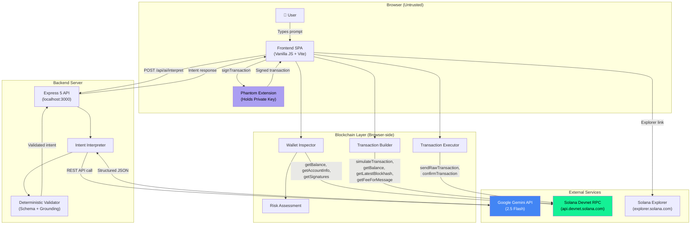

# SolGuard AI — Comprehensive Senior Engineer Audit

**Audit date:** 22 November 2026
**Auditor role:** Independent read-only review (Senior Staff Engineer, Blockchain Security Engineer, Technical Product Architect)
**Repository:** `/Users/binayakroy/SOLguard` — commit `a03f9b4` (HEAD → main)
**Runtime:** Node.js v24.20.0, npm 11.19.0, `@solana/web3.js` ^3.2.0, Express ^5.3.0, Vite ^8.3.6
**Network scope:** Solana Devnet only. No Mainnet path exists.
**Methodology:** Source-code inspection, test execution, dependency audit. No wallet connected, no transaction sent, no deployment made.

> [!IMPORTANT]
> **VERDICT: READY FOR CONTROLLED DEVNET TESTING**
> The project has genuine, well-engineered blockchain integration code — not just UI. Two open High findings (H-04 misleading risk score, H-05 duplicate-payout risk) block production but do not block safe Devnet testing with test SOL.

---

## Table of Contents

1. [Executive Summary](#1-executive-summary)
2. [Project Inventory and Structure](#2-project-inventory-and-structure)
3. [What Has Actually Been Built](#3-what-has-actually-been-built)
4. [SolGuard AI Explained Like I Am the Builder](#4-solguard-ai-explained-like-i-am-the-builder)
5. [System Architecture Audit](#5-system-architecture-audit)
6. [End-to-End Data Flow Audit](#6-end-to-end-data-flow-audit)
7. [Solana Devnet Readiness](#7-solana-devnet-readiness)
8. [Security Audit](#8-security-audit)
9. [API and Backend Audit](#9-api-and-backend-audit)
10. [Frontend Audit](#10-frontend-audit)
11. [Code Quality and Maintainability](#11-code-quality-and-maintainability)
12. [Testing and Verification Audit](#12-testing-and-verification-audit)
13. [Local Run Guide](#13-local-run-guide)
14. [Environment Variables and Secrets Audit](#14-environment-variables-and-secrets-audit)
15. [Deployment Audit and Guide](#15-deployment-audit-and-guide)
16. [Product and Market Readiness](#16-product-and-market-readiness)
17. [Prioritized Gap Analysis](#17-prioritized-gap-analysis)
18. [What Should We Do Next](#18-what-should-we-do-next)
19. [Final Readiness Scorecard](#19-final-readiness-scorecard)
20. [Final Verdict](#20-final-verdict)

---

## 1. Executive Summary

### What SolGuard AI Is

SolGuard AI is a **non-custodial AI-assisted Solana wallet security tool and transaction copilot** for Devnet. It lets a user describe a SOL transfer in plain English (e.g., "Send 0.5 SOL to `<address>`"), validates that instruction using a combination of Google Gemini AI and deterministic code rules, inspects the recipient's on-chain metadata, simulates the transaction on Devnet, and — only after the user explicitly reviews everything — opens Phantom for the user to approve and sign. It then submits the signed transaction to Devnet and confirms it.

### What Problem It Solves

Crypto transactions are unforgiving: send to the wrong address or the wrong amount, and there's no undo. SolGuard puts a **validation and review layer** between the user's natural-language intent and the actual blockchain transaction. It aims to catch errors, inspect unknown recipients, and ensure the user understands what they're approving.

### Who Its Users Are

Solana wallet users on Devnet who want an extra safety layer before transferring SOL, particularly users who may not be comfortable constructing raw transactions.

### What a User Can Currently Do

1. Connect a Phantom wallet (Devnet)
2. See their live Devnet SOL balance
3. Type a natural-language transfer request to the AI Copilot
4. Receive a validated, structured transfer intent
5. Have all recipients scanned against live Devnet RPC data
6. See a risk heuristic (metadata-based, not fraud detection)
7. Review a fully simulated transaction preview with fees
8. Open Phantom to approve and sign
9. Submit to Devnet and get a confirmed signature + Explorer link
10. Inspect any public wallet address (Wallet X-Ray / Security Scanner)
11. View session transaction history
12. Switch between dark/light themes

### Core Technical Architecture

- **Frontend:** Vanilla JavaScript SPA (Vite + TailwindCSS), no React/Vue
- **Backend:** Express 5 on Node.js 24, single API endpoint for AI interpretation
- **AI:** Google Gemini 2.5 Flash via REST API, with deterministic fallback parser
- **Blockchain:** `@solana/web3.js` v3 — real RPC calls, real transaction building, real simulation
- **Wallet:** Phantom browser extension via `window.phantom.solana`
- **Network:** Fixed Devnet only — Mainnet is code-blocked at build AND runtime

### What Has Been Completed

| Area | Status |
|---|---|
| AI intent interpretation with grounding validation | **VERIFIED** — 564 lines of real Gemini + fallback logic |
| Deterministic validation of AI output | **VERIFIED** — addresses/amounts traced back to user prompt |
| Multi-recipient atomic SOL transfers (up to 5) | **VERIFIED** — real `SystemProgram.transfer` instructions |
| Transaction simulation before signing | **VERIFIED** — `simulateTransaction` called twice (builder + executor) |
| Phantom wallet connection/signing | **IMPLEMENTED, NOT EXECUTION-VERIFIED** — real Phantom API calls, tested with doubles |
| Wallet X-Ray with live RPC data | **VERIFIED** — 3 concurrent RPC reads per inspection |
| Risk heuristic scoring | **VERIFIED** — deterministic metadata-based, honestly labeled |
| Memo Program provenance audit trail | **VERIFIED** — `SOLGUARD_V1 | OBSERVED_RISK: ...` written on-chain |
| Transaction confirmation + Explorer links | **VERIFIED** — `confirmTransaction` with timeout handling |
| Backend rate limiting, CORS, security headers | **VERIFIED** — tested in backend suite |
| Devnet-only enforcement at 4 layers | **VERIFIED** — config, build, runtime, and RPC all block Mainnet |
| 109 automated tests (82 unit + 19 backend + 8 integration) | **VERIFIED** — all pass |
| Phase 8 security audit with STRIDE threat model | **VERIFIED** — 19-page internal audit exists |
| Deployment configuration (Vercel + Render) | **IMPLEMENTED, NOT EXECUTION-VERIFIED** |

### What Remains Incomplete

1. **No `.env` file exists** — the project won't start without creating one
2. **No live Devnet transaction has been tested** — all tests use doubles/mocks
3. **Risk scoring is metadata-only** — always returns 0/100 "low" for valid addresses (H-04)
4. **No duplicate-payout prevention across page reloads** (H-05)
5. **No authentication on AI endpoint** (M-04)
6. **No frontend Content-Security-Policy** (M-06)
7. **Transaction history is session-only** — lost on reload
8. **No actual beta users recruited** — beta infrastructure exists but is unused
9. **No production deployment has been made**

### Biggest Technical Risks

1. Single public Devnet RPC is a single point of failure
2. Risk score gives false assurance (0/100 for every normal address)
3. No persistent transaction state — confirmation timeout + reload = potential double-payout

### Biggest Security Risks

1. Unauthenticated AI endpoint — anyone can burn Gemini API quota
2. No CSP on the frontend — XSS could compromise the wallet flow
3. Phantom provider identity relies on a spoofable `isPhantom` flag

### Biggest Devnet Blockers

1. Missing `.env` file — must be created from `.env.example`
2. Missing Gemini API key (falls back to deterministic parser without it)
3. Phantom must be installed and switched to Devnet

### Project Readiness Assessment

> **This is a TECHNICAL PROTOTYPE approaching functional MVP.**
>
> It is well-architected and significantly more complete than a typical student project. The blockchain integration is real, not simulated. The security thinking is genuine, with a formal threat model. However, it has never been tested end-to-end with a real wallet and real Devnet transactions. That is the immediate next step.

---

## 2. Project Inventory and Structure

### Directory Tree

```
SOLguard/
├── frontend/                    # Vite-hosted vanilla JS frontend
│   ├── index.html               # App shell with navigation, wallet button, theme
│   ├── public/
│   │   ├── boot.js              # Font loading, theme initialization
│   │   └── favicon.svg
│   └── src/
│       ├── main.js              # Entry point — imports CSS, calls mountApp()
│       ├── app.js               # 1,280 lines — the entire application controller
│       ├── config/runtime.js    # API URL, environment, Mainnet guard
│       ├── utils/solana-address.js  # Pure Base58 address validator (no web3.js)
│       ├── pages/               # Page renderers (return HTML strings)
│       │   ├── dashboard.js     # Command Center with wallet overview, security, activity
│       │   ├── copilot.js       # AI Copilot transfer workspace
│       │   ├── scanner.js       # Security Scanner
│       │   ├── xray.js          # Wallet X-Ray
│       │   ├── history.js       # Session transaction history
│       │   └── settings.js      # Network, integrations, security boundaries
│       ├── components/          # Reusable UI components
│       │   ├── icons.js         # SVG icon system
│       │   ├── ui.js            # Shared UI primitives
│       │   ├── copilot-composer.js      # Prompt input with examples
│       │   ├── intent-result.js         # AI interpretation display
│       │   ├── transaction-confirmation.js  # Transaction review/execution UI
│       │   ├── wallet-inspection.js     # Wallet scan results display
│       │   ├── activity-table.js        # Transaction history table
│       │   ├── beta-onboarding.js       # Beta welcome guide
│       │   └── beta-feedback.js         # Beta feedback form
│       ├── services/
│       │   ├── wallet/phantom-wallet.js # Phantom connection, signing, events
│       │   ├── blockchain/
│       │   │   ├── lazy-blockchain.js   # Lazy-loads blockchain modules
│       │   │   ├── wallet-balance.js    # Live Devnet balance via RPC
│       │   │   └── session-transaction-history.js  # In-memory tx records
│       │   ├── security/scan-history.js # Session scan records
│       │   ├── theme/theme.js           # Dark/light/system theme
│       │   ├── telemetry.js             # Client error reporting
│       │   └── analytics.js             # Anonymous product analytics
│       └── styles/              # TailwindCSS 4 + custom CSS
│           ├── tokens.css       # Design tokens
│           ├── base.css         # Reset, typography
│           ├── layout.css       # App shell layout
│           ├── components.css   # Component styles
│           ├── features.css     # Feature-specific styles
│           ├── overview.css     # Dashboard styles
│           ├── beta.css         # Beta program styles
│           └── motion.css       # Animations, reduced-motion
│
├── backend/                     # Express 5 API server
│   └── src/
│       ├── server.js            # HTTP listener, shutdown, signals
│       ├── app.js               # Express app factory with all routes
│       ├── config/runtime.js    # Environment validation, Mainnet lock
│       ├── routes/
│       │   ├── ai.js            # POST /api/ai/interpret
│       │   ├── telemetry.js     # POST /api/telemetry/event
│       │   ├── analytics.js     # POST /api/analytics/event
│       │   ├── feedback.js      # POST /api/feedback
│       │   └── metrics.js       # GET /api/metrics (token-protected)
│       ├── services/gemini/
│       │   └── intent-interpreter.js  # 564 lines — Gemini + fallback + grounding
│       ├── middleware/
│       │   ├── cors.js          # Origin allowlist
│       │   ├── ai-rate-limit.js # 10 req/60s per IP
│       │   ├── beta-rate-limit.js    # Analytics/feedback limits
│       │   └── telemetry-rate-limit.js
│       ├── validators/
│       │   ├── intent.js        # Schema + semantic intent validation
│       │   └── schema-validator.js   # AJV 2020 against shared schemas
│       └── observability/
│           ├── logger.js        # Structured JSON logger
│           ├── metrics.js       # In-memory metrics registry
│           └── webhook.js       # Webhook delivery
│
├── blockchain/                  # Solana domain layer
│   └── src/
│       ├── config/network.js    # Devnet constants, Mainnet guard, RPC URL
│       ├── rpc/
│       │   ├── devnet-connection.js  # Singleton Connection to Devnet
│       │   └── read-retry.js    # Bounded retry for read-only RPC
│       ├── transactions/
│       │   ├── transaction-builder.js   # 303 lines — builds, validates, simulates
│       │   └── transaction-executor.js  # 449 lines — signs, submits, confirms
│       ├── security/
│       │   ├── transaction-risk.js      # Aggregates per-recipient risk
│       │   └── risk-assessment.js       # Heuristic risk scoring
│       └── inspection/
│           └── wallet-security.js       # 201 lines — live RPC wallet inspection
│
├── shared/                      # Shared between frontend/backend/blockchain
│   ├── schemas/                 # JSON Schema 2020-12 contracts
│   │   ├── TransactionIntent.schema.json
│   │   ├── TransactionPreview.schema.json
│   │   ├── TransactionResult.schema.json
│   │   ├── IntentCandidate.schema.json
│   │   ├── InterpretationCandidate.schema.json
│   │   ├── Recipient.schema.json
│   │   ├── RiskAssessment.schema.json
│   │   └── WalletSecurityReport.schema.json
│   └── validation/
│       └── transaction-intent.js  # Shared validation: public keys, amounts, semantics
│
├── tests/
│   ├── unit/           # 14 test files, 82 tests — all pass
│   ├── backend/        # 7 test files, 19 tests — all pass
│   ├── integration/    # 3 test files, 8 tests pass, 1 skipped (live Devnet)
│   └── e2e/            # Playwright browser tests (not run — requires Chromium)
│
├── scripts/            # Build/check/deploy scripts
├── docs/               # 15+ architecture/security/deployment documents
├── config/environments/  # Env templates for local/staging/production
├── .github/workflows/    # CI + deploy GitHub Actions
├── package.json         # Dependencies and scripts
├── vite.config.js       # Vite build with Mainnet guards
├── vercel.json          # Frontend deployment config
├── render.yaml          # Backend deployment config
└── .env.example         # Environment template (no .env committed)
```

### Key Architectural Relationships

| Folder | Responsibility | Communicates With |
|---|---|---|
| `frontend/src/app.js` | Application controller — routes, state, event handling | All pages, components, services |
| `backend/src/services/gemini/` | AI interpretation (Gemini API + fallback) | Gemini REST API, shared validators |
| `blockchain/src/transactions/` | Transaction building, simulation, execution | Solana RPC, Phantom (via frontend) |
| `blockchain/src/inspection/` | Live wallet security inspection | Solana RPC |
| `shared/` | Schema contracts, validation functions | Used by both backend and blockchain |

---

## 3. What Has Actually Been Built

| Feature | Status | Frontend | Backend | External Integration | Verified Evidence | Remaining Work |
|---|---|---|---|---|---|---|
| AI Copilot | **VERIFIED** | Complete — prompt, response, examples | 564-line interpreter with Gemini + fallback | Google Gemini 2.5 Flash | Tests pass; grounding validation traced | Needs Gemini API key to test live |
| Natural-language interpretation | **VERIFIED** | Renders structured intent | Deterministic validation, schema checks | Gemini structured output | 20+ unit tests on parsing/grounding | None for core flow |
| SOL transfer (single) | **IMPLEMENTED, NOT EXECUTION-VERIFIED** | Full review/approval UI | Validation, simulation, signing, submission | Solana RPC, Phantom, Memo Program | Tests with doubles; no live tx | Live Devnet test needed |
| Multi-recipient transfers (up to 5) | **IMPLEMENTED, NOT EXECUTION-VERIFIED** | Multi-recipient display | Atomic transaction with N transfers + memo | Same | Integration tests with doubles | Live Devnet test needed |
| Transaction validation | **VERIFIED** | Error display for all failure states | 7 shared schemas, semantic validation | None | Schema tests, intent tests | None |
| Transaction review/confirmation | **VERIFIED** | Detailed preview with fees, risk, memo | Simulation result displayed | None | UI renders all states | None |
| Wallet connection (Phantom) | **IMPLEMENTED, NOT EXECUTION-VERIFIED** | Connect/disconnect/restore UI | N/A (browser-only) | Phantom extension API | 10 unit tests with mock provider | Live Phantom test needed |
| Wallet X-Ray | **IMPLEMENTED, NOT EXECUTION-VERIFIED** | Full investigation UI | N/A (browser-side RPC) | Solana Devnet RPC | Wallet inspection unit tests | Live RPC test needed |
| Security Scanner | **IMPLEMENTED, NOT EXECUTION-VERIFIED** | Same as X-Ray with scanner context | N/A | Solana Devnet RPC | Same tests | Live test needed |
| Risk scoring | **VERIFIED** | Displays score, category, indicators | Deterministic metadata heuristic | None | 7 risk-related tests | Scoring engine needs real signals (H-04) |
| Transaction history | **VERIFIED** | Table with search/filter/status | N/A (session memory) | None | 4 unit tests | Session-only; not persisted |
| Explorer links | **VERIFIED** | Clickable Devnet Explorer URLs | Generated from signature | Solana Explorer | URL construction verified | None |
| Solana RPC connectivity | **IMPLEMENTED, NOT EXECUTION-VERIFIED** | Balance display, RPC status | N/A | `api.devnet.solana.com` | Connection created, not tested live | Live connectivity test needed |
| Memo Program | **VERIFIED** | Memo shown in preview | `SOLGUARD_V1` provenance memo added to tx | Solana Memo Program | Builder tests, memo verification | None for implementation |
| Devnet-only enforcement | **VERIFIED** | Build-time + runtime guards | Config rejects Mainnet | 4-layer guard | Tests verify rejection | None — this works |
| Dashboard | **VERIFIED** | Wallet overview, security posture, activity | N/A | None | Renders correctly | Displays session data only |
| Settings | **VERIFIED** | Network, integrations, security rules | N/A | None | Renders correctly | Static display only |
| Rate limiting | **VERIFIED** | Error display on 429 | 10 req/60s per IP on AI | None | Backend test verifies | No shared store (single-instance) |
| CORS | **VERIFIED** | N/A | Origin allowlist, preflight handling | None | Backend test with origins | None |
| Deployment config | **IMPLEMENTED, NOT EXECUTION-VERIFIED** | `vercel.json` with CSP headers | `render.yaml` with health checks | Vercel, Render | Config files reviewed | Never deployed |
| Beta program | **UI ONLY** | Onboarding, feedback forms, analytics consent | Webhook forwarding endpoints | External webhooks | Routes exist but no webhooks configured | No beta users, no webhooks |
| Theme system | **VERIFIED** | Dark (Midnight), Light (Daylight), System | N/A | None | CSS tokens, localStorage | Works |
| Accessibility | **PARTIALLY IMPLEMENTED** | ARIA labels, skip link, focus management | N/A | None | Structures in HTML | Needs comprehensive audit |

---

## 4. SolGuard AI Explained Like I Am the Builder

### What happens when a user opens SolGuard AI?

When you open SolGuard in a browser, Vite serves a single HTML page. JavaScript loads and builds the entire interface: a sidebar with navigation, a top bar with wallet connection, and a main content area. It tries to silently reconnect to Phantom (a browser extension for Solana wallets) if the user previously connected. If Phantom is installed and the user trusted SolGuard before, their wallet address and Devnet balance appear automatically.

### What is the frontend responsible for?

The frontend is the part that runs in your browser. It:
- Shows the interface (pages, buttons, forms, results)
- Collects user input (prompts, addresses)
- Sends prompts to the backend for AI interpretation
- Calls Solana Devnet directly (through JavaScript) to check wallet balances and inspect addresses
- Builds the actual Solana transaction (this happens in browser JavaScript, not on the server)
- Asks Phantom to sign the transaction
- Submits the signed transaction to Devnet
- Shows the result with an Explorer link

### What is the backend responsible for?

The backend is a small server (Express, running on Node.js) that does only a few things:
- **AI interpretation** — receives the user's plain-English prompt, sends it to Google Gemini, validates the response, and returns a structured transfer intent
- **Rate limiting** — prevents abuse (max 10 AI requests per minute per user)
- **Telemetry/analytics/feedback** — optional data collection endpoints for beta
- **Health check** — a simple "I'm alive" endpoint

**The backend does NOT touch the wallet, build transactions, sign anything, or send transactions to Solana.** That all happens in the browser.

### Why does SolGuard AI use an AI model?

The AI (Google Gemini) translates natural language into structured data. When you type "Send 0.5 SOL to `AbCdEf...`", Gemini extracts: recipient = `AbCdEf...`, amount = `0.5`, intent = `transfer`. This is easier than making users fill out a form with technical fields.

### What does Gemini actually do?

Gemini receives your prompt and returns a JSON object with:
- Status (ready / clarification needed / unsupported)
- Recipient address(es)
- Amount(s) in SOL
- Distribution type (equal split or explicit amounts)
- An explanation

It does this using "structured output" — Gemini is told exactly what JSON shape to return, with a temperature of 0 (no creativity).

### What does Gemini NOT have permission to do?

Gemini **cannot**:
- Access your wallet
- Sign transactions
- Send transactions
- Move funds
- See your balance
- See your private keys
- Execute any code

Gemini is literally just a text-to-JSON translator. The backend sends it your prompt, gets back JSON, then **throws away anything that doesn't match strict rules**.

### Why must AI-generated instructions be validated by deterministic code?

AI models can "hallucinate" — they can invent addresses that weren't in your prompt, change amounts, or make up information. SolGuard's deterministic validator (regular code, not AI) checks that:
- Every address in the AI's response actually appears in your original prompt
- Every amount matches what you typed
- Amounts are paired with the correct addresses
- Totals add up mathematically
- No memo was invented that you didn't write

If ANY of these checks fail, the AI response is rejected and the app asks you for clarification.

### What role does Phantom play?

Phantom is a browser extension that holds your Solana private key (think of it like a password that proves you own your wallet). SolGuard never sees or touches your private key. Instead:
1. SolGuard builds a transaction (the instructions for what to send, where, and how much)
2. SolGuard hands that transaction to Phantom
3. Phantom shows you the transaction details
4. YOU click "Approve" in Phantom
5. Phantom signs it with your private key and hands the signed transaction back
6. SolGuard then submits the signed transaction to Devnet

### What is a Solana public key?

A public key is your wallet address — like a bank account number. It's safe to share publicly. It's a string of 32–44 characters using special characters (Base58). Example: `7EcDhSYGxXyscszYEp35KHN8vvw3svAuLKTzXwCFLtV`. Anyone can send SOL to this address, and anyone can look up its balance and transaction history on the public blockchain.

### What is a wallet signature?

A digital signature proves that the owner of a wallet (the person who has the private key) authorized a specific transaction. Without a valid signature, Solana rejects the transaction. Only Phantom has access to your private key, and it only signs when you click "Approve." SolGuard cannot forge this signature.

### What is the Solana RPC?

RPC (Remote Procedure Call) is how software talks to the Solana blockchain. Think of it as an API for the blockchain. SolGuard uses the public Devnet RPC at `https://api.devnet.solana.com` to:
- Check wallet balances
- Get account information
- Simulate transactions (test them without actually sending)
- Submit signed transactions
- Confirm whether a transaction succeeded

### What is Devnet?

Devnet is Solana's test network. It works exactly like the real Solana network (Mainnet), but the SOL on Devnet has no real monetary value. You can get free Devnet SOL from a "faucet" (a website that gives away test tokens). It's used for testing without risking real money.

### What is the difference between Devnet and Mainnet?

| | Devnet | Mainnet |
|---|---|---|
| SOL value | \$0 (test tokens) | Real money |
| Purpose | Testing and development | Real transactions |
| Risk | None — worst case you lose free test tokens | Real — mistakes lose real money |
| Getting SOL | Free from faucets | Buy with real money |
| RPC endpoint | `api.devnet.solana.com` | `api.mainnet-beta.solana.com` |

**SolGuard is locked to Devnet.** The code actively prevents Mainnet at 4 separate layers.

### Walk-through: "Send 0.1 SOL to this address"

Here's what **actually happens** in the existing code when you type this:

**Step 1 — You type the prompt**
In the AI Copilot page, you type: `Send 0.1 SOL to 7EcDhSYGxXyscszYEp35KHN8vvw3svAuLKTzXwCFLtV`

**Step 2 — Frontend sends to backend**
`app.js` → `handleCopilotSubmit()` → `fetch('/api/ai/interpret', { body: { prompt: "Send 0.1 SOL to 7EcDh..." } })`

**Step 3 — Backend interprets**
`routes/ai.js` checks rate limit → `intent-interpreter.js` sends prompt to Gemini API → Gemini returns structured JSON → Validator checks every field against the original prompt → Returns `{ status: "ready", intent: { recipients: [{ address: "7EcDh...", amountLamports: "100000000" }] } }`

If Gemini API key is missing, the **fallback parser** uses regex to extract the address and amount directly from the prompt text.

**Step 4 — Frontend shows the interpreted intent**
`renderCopilotResponse()` displays: recipient, amount, source (Gemini or fallback), and a "Scan and prepare transfer" button.

**Step 5 — You click "Scan and prepare"**
`scanIntentRecipients()` runs. First it checks you're connected to Phantom. Then:

**Step 6 — Recipient inspection**
`inspectWalletSecurity("7EcDh...")` makes 3 concurrent RPC calls to Devnet:
- `getBalance` — how much SOL the recipient has
- `getAccountInfo` — what type of account it is
- `getSignaturesForAddress` — last 20 transactions

The results are assessed by `assessWalletRisk()` — a deterministic heuristic that checks metadata but currently always returns `0/100 low` for normal accounts (this is H-04).

**Step 7 — Transaction building + simulation**
`prepareSolTransferTransaction()` runs:
1. Validates the intent (addresses, amounts, network)
2. Checks sender ≠ recipient, no duplicates
3. Gets fresh blockhash from Devnet
4. Gets sender balance from Devnet
5. Builds a Solana `Transaction` with `SystemProgram.transfer` + `Memo Program` instruction
6. Estimates the fee
7. Checks balance covers transfers + fee
8. **Simulates the transaction** on Devnet (dry run)
9. Returns a preview with all details

**Step 8 — You review the preview**
The UI shows: sender, recipient, amount in SOL and lamports, network fee, risk summary, provenance memo, simulation status. A button says "Open Phantom for explicit approval."

**Step 9 — You click approve**
`approvePreparedTransfer()` runs:
1. **Rebuilds** the transaction from the preview (not the mutable object — security fix H-01)
2. Compares the rebuilt message byte-by-byte with the prepared one
3. Re-checks blockhash hasn't expired
4. Re-checks sender balance
5. **Re-simulates** the transaction
6. Calls `phantomWallet.signTransaction()` — this opens Phantom's popup
7. YOU review in Phantom and click Approve (or Reject)

**Step 10 — Submission and confirmation**
After signing:
1. Verifies the signed message matches the expected message
2. Serializes the transaction
3. `connection.sendRawTransaction()` submits to Devnet
4. `connection.confirmTransaction()` waits for confirmation (up to 60 seconds)
5. `verifyOnChainMemo()` checks the provenance memo was written correctly
6. Returns result: `confirmed` / `failed` / `submitted` (timeout)

**Step 11 — Result display**
The UI shows the transaction signature, Explorer link, confirmation status, and memo verification status.

### What is different between the ideal flow and the actual implementation?

The ideal flow described above is **fully implemented in code**. The difference is: **it has never been executed with a real Phantom wallet and real Devnet RPC.** All tests use "doubles" (fake Phantom, fake RPC). The code is real, the architecture is sound, but no one has pressed the button with actual Devnet SOL yet.

---

## 5. System Architecture Audit

### Technology Stack

| Component | Technology | Version |
|---|---|---|
| Frontend framework | Vanilla JavaScript (no React/Vue/Angular) | ES2022+ modules |
| CSS framework | TailwindCSS 4 | ^4.3.5 |
| Build tool | Vite | ^8.3.6 |
| Backend runtime | Node.js | 24.20.0 (LTS) |
| Backend framework | Express | ^5.3.0 |
| AI provider | Google Gemini | 2.5 Flash (default) |
| Solana SDK | @solana/web3.js | ^3.2.0 |
| Wallet integration | Phantom extension | Direct provider API |
| RPC provider | Solana public Devnet | `api.devnet.solana.com` |
| Schema validation | AJV | ^8.20.0 (JSON Schema 2020-12) |
| Testing | Node.js built-in test runner | `node --test` |
| E2E testing | Playwright | ^1.65.1 |
| Package manager | npm | 11.19.0 |

### Architecture Diagram



### Trust Boundaries

| Boundary | What crosses it | Control |
|---|---|---|
| User → Frontend | Prompts, addresses, clicks | Input validation, address canonicalization |
| Frontend → Backend | Prompt text only | 8KB body limit, 1800-byte prompt limit, rate limiting |
| Backend → Gemini | Prompt + system instruction | Closed schema, timeout, header-based auth |
| Gemini → Backend | Structured JSON response | Schema validation, grounding checks, fallback |
| Frontend → Phantom | Unsigned transaction | Account binding, message comparison |
| Phantom → Frontend | Signed transaction | Byte-for-byte message verification |
| Frontend → Solana RPC | Read calls + signed bytes | Fixed Devnet endpoint, commitment level |
| **Missing boundary** | Frontend has no CSP | XSS could compromise entire flow |

---

## 6. End-to-End Data Flow Audit

### A. AI Copilot

**User prompt → `app.js:handleCopilotSubmit()` → `fetch('/api/ai/interpret')` → `routes/ai.js` (rate limit: 10/60s, body validation: prompt-only, ≤1800 bytes) → `intent-interpreter.js:interpretNaturalLanguage()`**

**If Gemini API key exists:**
→ `requestGemini()` → REST POST to `generativelanguage.googleapis.com` with `x-goog-api-key` header, closed `responseSchema`, `temperature: 0`, 15s timeout
→ Response parsed → `normalizeCandidate()` (AJV schema validation)
→ `validateCandidateGrounding()` — checks every address/amount/total/memo against original prompt
→ If grounding fails → falls back to deterministic parser

**If no API key or Gemini fails:**
→ `fallbackCandidate()` — regex-based extraction of addresses + amounts
→ Supports: single transfer, equal split, explicit multi-recipient

**AI hallucination risk:** **MITIGATED.** The grounding validator is thorough:
- Extracts all public keys from prompt, requires exact match with AI output
- Extracts all SOL amounts, requires exact lamport match
- For explicit distributions, requires amount paired with specific address
- Rejects invented memos
- Falls back (never trusts unvalidated AI output)

**Evidence:** [intent-interpreter.js](file:///Users/binayakroy/SOLguard/backend/src/services/gemini/intent-interpreter.js#L170-L266) `validateCandidateGrounding()`

### B. Single SOL Transfer

Full trace through the actual code:

1. **Recipient supplied:** From AI interpretation or fallback parser — extracted from user prompt text
2. **Amount interpreted:** `solAmountToLamports()` in [shared/validation/transaction-intent.js](file:///Users/binayakroy/SOLguard/shared/validation/transaction-intent.js#L28-L46) — exact decimal-to-BigInt conversion, rejects 0, negatives, >u64
3. **Address validated:** `assertCanonicalPublicKey()` — Base58 decode + re-encode comparison
4. **Balance checked:** [transaction-builder.js L199](file:///Users/binayakroy/SOLguard/blockchain/src/transactions/transaction-builder.js#L199) — `connection.getBalance(payer)`
5. **Fee estimated:** [transaction-builder.js L243](file:///Users/binayakroy/SOLguard/blockchain/src/transactions/transaction-builder.js#L243) — `connection.getFeeForMessage()`
6. **Balance ≥ transfer + fee:** [transaction-builder.js L253](file:///Users/binayakroy/SOLguard/blockchain/src/transactions/transaction-builder.js#L253)
7. **Transaction created:** [transaction-builder.js L219-238](file:///Users/binayakroy/SOLguard/blockchain/src/transactions/transaction-builder.js#L219-L238) — `SystemProgram.transfer` + Memo Program instruction
8. **Simulation:** [transaction-builder.js L271](file:///Users/binayakroy/SOLguard/blockchain/src/transactions/transaction-builder.js#L271) — `connection.simulateTransaction()`
9. **Phantom invoked:** [transaction-executor.js L329](file:///Users/binayakroy/SOLguard/blockchain/src/transactions/transaction-executor.js#L329) — `signTransaction(reviewedTransaction)`
10. **User approves:** In Phantom popup
11. **Message verified:** [transaction-executor.js L349](file:///Users/binayakroy/SOLguard/blockchain/src/transactions/transaction-executor.js#L349) — byte comparison
12. **Broadcasting:** [transaction-executor.js L371](file:///Users/binayakroy/SOLguard/blockchain/src/transactions/transaction-executor.js#L371) — `connection.sendRawTransaction()`
13. **Confirmation:** [transaction-executor.js L392-398](file:///Users/binayakroy/SOLguard/blockchain/src/transactions/transaction-executor.js#L392-L398) — `connection.confirmTransaction()` with 60s timeout
14. **Explorer URL:** [transaction-executor.js L22-24](file:///Users/binayakroy/SOLguard/blockchain/src/transactions/transaction-executor.js#L22-L24) — `https://explorer.solana.com/tx/${signature}?cluster=devnet`

**Status: IMPLEMENTED, NOT EXECUTION-VERIFIED** — all code paths exist and are tested with doubles.

### C. Multi-Recipient Transfer

- Parsing: Fallback parser handles "X SOL to A, Y SOL to B" and "Split Z SOL equally between A, B, C"
- Validation: Each recipient independently validated
- Duplicate addresses: **Rejected** — [transaction-builder.js L172-174](file:///Users/binayakroy/SOLguard/blockchain/src/transactions/transaction-builder.js#L172-L174)
- Max recipients: **5** — enforced at schema, builder, and executor levels
- Atomicity: **VERIFIED** — single `Transaction` object with multiple `SystemProgram.transfer` instructions = atomic (all or nothing)
- Total calculation: Builder sums all recipient amounts
- Balance check: Total + fee ≤ sender balance

### D. Wallet X-Ray

- **Live RPC data:** 3 concurrent calls via `Promise.allSettled` — balance, accountInfo, signatures
- **Retry:** `retryRead()` with 2 attempts, 200ms base delay, exponential backoff
- **Account classification:** system_account / program / program_owned_account / not_found / unknown
- **Signature history:** Up to 20 recent signatures with slot, blockTime, failure status
- **Risk assessment:** Metadata heuristic — currently all indicators have `scoreContribution: 0`
- **No simulated data:** All data comes from live RPC or is marked as unavailable

**Status: IMPLEMENTED, NOT EXECUTION-VERIFIED** — real RPC calls, tested with doubles

### E. Security Scanner and Risk Scoring

- **Inputs:** Public wallet address
- **Data sources:** Solana Devnet RPC only
- **Rules:** Balance observation, account type, history availability, failed signatures
- **Scoring:** All current indicators contribute 0 points → **every assessable address gets 0/100 "low"**
- **This is honest but misleading.** The code explicitly says "No risk signals are assessed by this limited metadata heuristic" but users see "0/100 Low" which feels reassuring.

**Status: VERIFIED as implemented; KNOWN ISSUE (H-04)**

### F. Transaction History

- **Source:** In-memory JavaScript array (`session-transaction-history.js`)
- **Not from:** RPC, Explorer, backend, wallet, mock data, or hardcoded arrays
- **Data:** Records created when user prepares a transaction, updated with result
- **Persistence:** None — cleared on page reload
- **Status logic:** pending → submitted → confirmed/failed/rejected

**Status: VERIFIED** — genuinely session-only, honestly labeled

---

## 7. Solana Devnet Readiness — Priority Audit

### 7.1 Current Devnet State

| Question | Answer | Evidence |
|---|---|---|
| Configured for Devnet? | **Yes** | `SOLANA_NETWORK=devnet` in [.env.example L13](file:///Users/binayakroy/SOLguard/.env.example#L13), `VITE_SOLANA_NETWORK=devnet` in [.env.example L35](file:///Users/binayakroy/SOLguard/.env.example#L35) |
| Devnet is default? | **Yes** | `network.js` defaults to 'devnet'; config defaults to 'devnet' |
| RPC URL configured? | **Yes** | `https://api.devnet.solana.com` in [.env.example L36](file:///Users/binayakroy/SOLguard/.env.example#L36) |
| Public RPC or provider? | **Public** | Solana's free public Devnet endpoint |
| RPC endpoint valid? | **Yes** | Standard Solana Devnet URL |
| Network switching controls? | **No** | Fixed to Devnet — no switcher UI or config |
| Can accidentally use Mainnet? | **No** | 4-layer block: [vite.config.js L22-24](file:///Users/binayakroy/SOLguard/vite.config.js#L22-L24), [network.js L7-12](file:///Users/binayakroy/SOLguard/blockchain/src/config/network.js#L7-L12), [runtime.js L80-85](file:///Users/binayakroy/SOLguard/backend/src/config/runtime.js#L80-L85), [frontend runtime.js L7-9](file:///Users/binayakroy/SOLguard/frontend/src/config/runtime.js#L7-L9) |
| Network labels correct? | **Yes** | "Devnet" shown in dashboard, settings, sidebar |
| Wallet cluster match enforced? | **Partially** | App uses fixed Devnet RPC; doesn't check Phantom's cluster setting |
| Backend same cluster as frontend? | **Yes** | Both use `devnet` |
| Explorer URLs correct? | **Yes** | `?cluster=devnet` appended — [transaction-executor.js L23](file:///Users/binayakroy/SOLguard/blockchain/src/transactions/transaction-executor.js#L23) |
| Network constants centralized? | **Yes** | In `blockchain/src/config/network.js` |

### 7.2 Devnet Integration Checklist

- [x] Devnet RPC configured — `https://api.devnet.solana.com`
- [x] Frontend network configuration verified — `VITE_SOLANA_NETWORK=devnet`, build rejects non-devnet
- [x] Backend network configuration verified — `SOLANA_NETWORK=devnet`, runtime rejects non-devnet
- [ ] Phantom Devnet configuration understood — ⚠️ No wallet cluster mismatch detection
- [ ] Wallet connection works — Not tested with live Phantom
- [x] Wallet address displayed correctly — Code traces public key to Base58
- [ ] Wallet disconnect works — Not tested with live Phantom
- [ ] Network mismatch detected — Not implemented (app doesn't check Phantom cluster)
- [ ] Devnet balance retrieved live — Not tested against live RPC
- [x] Devnet faucet process documented — README mentions Devnet SOL
- [x] Recipient public key validation works — `assertCanonicalPublicKey()` tested
- [x] Amount validation works — `solAmountToLamports()` tested
- [x] Fee estimate works — `getFeeForMessage()` called
- [x] Transaction simulation works — `simulateTransaction()` called twice
- [x] Transaction constructed correctly — Tested with doubles
- [ ] Wallet signing flow works — Not tested with live Phantom
- [ ] Transaction submission works — Not tested against live RPC
- [ ] Transaction signature returned — Not tested live
- [x] Confirmation status tracked — Code handles confirmed/failed/timeout
- [x] Explorer link correct — `?cluster=devnet` verified
- [ ] Transaction history uses live data — Session-only; no live query
- [x] RPC failure handled — All RPC calls wrapped with error handling
- [x] Wallet rejection handled — `USER_REJECTED` code detected
- [x] Transaction timeout handled — 60s timeout with "submitted" status
- [ ] Duplicate submission protection — Session-only guard; cleared on reload (H-05)
- [x] No private key or seed phrase requested — Verified by search
- [x] No sensitive wallet data leaked to logs — Logger only logs event names
- [x] No unintended Mainnet transaction possible — 4-layer guard verified

### 7.3 What Is Required to Connect Devnet

**What Devnet is:** A free test version of Solana. Same technology, same rules, but the tokens are free and worthless. It's a playground.

**What a Devnet wallet is:** A Phantom wallet switched to Devnet mode. Same extension, different network. Your Mainnet wallet and Devnet wallet have different balances (even if same address).

**How Phantom network selection works:** In Phantom → Settings → Developer Settings → Change Network → Devnet. This tells Phantom to show your Devnet balance and sign Devnet transactions.

**How Devnet SOL differs from real SOL:** Devnet SOL is free. You can get it from faucets like `faucet.solana.com`. It has no monetary value.

**What an RPC endpoint does:** It's the "phone number" for talking to Solana. SolGuard calls this endpoint to check balances, simulate transactions, and submit signed transactions.

**Why frontend and backend settings must agree:** The backend validates that your request targets Devnet. The frontend builds transactions for Devnet. If they disagreed, the transaction would be rejected.

**Why connecting a wallet does not mean the app can take funds:** Connecting gives SolGuard your public address (like giving someone your email address). To move funds, SolGuard must build a transaction and you must explicitly approve it in Phantom. Without your approval in Phantom, nothing can be sent.

---

## 8. Security Audit

### Security Findings Summary

| ID | Severity | Description | Blocks Devnet? | Blocks Mainnet? |
|---|---|---|---|---|
| SEC-01 | **HIGH** | Risk score always 0/100 for valid addresses — false assurance | No | Yes |
| SEC-02 | **HIGH** | Duplicate-payout risk after confirmation timeout + reload | No | Yes |
| SEC-03 | **MEDIUM** | Unauthenticated AI endpoint — Gemini quota abuse | No | Yes |
| SEC-04 | **MEDIUM** | No frontend CSP — XSS could compromise wallet flow | No | Yes |
| SEC-05 | **MEDIUM** | Single fixed RPC — single point of trust/failure | No | Yes |
| SEC-06 | **MEDIUM** | No wallet cluster mismatch detection | No | Yes |
| SEC-07 | **MEDIUM** | Phantom provider identity based on spoofable flag | No | Yes |
| SEC-08 | **LOW** | Simulation log fragments may leak to client | No | No |
| SEC-09 | **LOW** | No persistent audit trail | No | No |
| SEC-10 | **LOW** | No rent-exemption precheck | No | Yes |
| SEC-11 | **INFO** | No CORS wildcard — proper origin allowlist | N/A | N/A |
| SEC-12 | **INFO** | No private key handling — verified | N/A | N/A |
| SEC-13 | **INFO** | 0 known dependency vulnerabilities | N/A | N/A |
| SEC-14 | **INFO** | AI cannot sign or submit transactions | N/A | N/A |

### AI Security

- **Prompt injection:** Mitigated — system instruction marks prompt as untrusted data; deterministic validator ignores claimed authority
- **Malicious recipient addresses:** **Protected** — `extractPublicKeys()` only accepts canonical Base58 public keys that decode correctly
- **AI-generated parameter manipulation:** **Protected** — `validateCandidateGrounding()` rejects any address/amount not explicitly in the prompt
- **Incorrect amount extraction:** **Protected** — exact lamport comparison, not floating-point
- **AI hallucination:** **Protected** — grounding validation rejects invented data; fallback on failure
- **Invalid JSON:** **Protected** — structured output with closed schema; fallback on parse error
- **API key exposure:** **Fixed** — key sent in `x-goog-api-key` header, never in URL
- **Prompt leakage:** **Protected** — prompts not logged; only event names in structured logs

### Wallet Security

- **Connection:** ✅ Standard `provider.connect()` flow
- **Signing permissions:** ✅ `signTransaction` only called after explicit user action
- **Transaction approval:** ✅ Phantom popup requires user click
- **Wallet disconnect:** ✅ `provider.disconnect()` implemented
- **Unauthorized signing:** ✅ Not possible — requires Phantom approval
- **Transaction contents shown:** ✅ Full preview displayed before Phantom
- **Transaction manipulation before signing:** ✅ Transaction rebuilt from preview; byte comparison (H-01 fix)
- **Network mismatch:** ⚠️ App doesn't check Phantom's selected cluster (SEC-06)

### Transaction Security

- **Address validation:** ✅ Canonical Base58 check with re-encode comparison
- **Amount validation:** ✅ Exact decimal-to-BigInt, rejects 0 and >u64
- **Insufficient balance:** ✅ Checked with fee included
- **Fee estimation:** ✅ `getFeeForMessage()` called
- **Transaction simulation:** ✅ Performed twice (builder + executor)
- **Multiple recipients:** ✅ Atomic, max 5, no duplicates, no self-transfer
- **Transaction replay:** ⚠️ Session guard only; cleared on reload (SEC-02/H-05)
- **Confirmation handling:** ✅ 60s timeout with explicit "submitted" status

### Backend Security

- **API key handling:** ✅ Server-side only, header transport, never in frontend
- **CORS:** ✅ Explicit origin allowlist, rejects unknown origins
- **Rate limiting:** ✅ 10/60s per IP on AI endpoint
- **Input validation:** ✅ Strict JSON schema, 8KB body limit
- **Error messages:** ✅ Generic client-safe messages
- **No authentication:** ⚠️ AI endpoint has no auth (SEC-03/M-04)
- **Security headers:** ✅ X-Content-Type-Options, X-Frame-Options, CSP (API only), HSTS, Permissions-Policy

### Frontend Security

- **XSS:** ⚠️ User strings are escaped in template literals but no CSP exists (SEC-04/M-06)
- **Local storage:** ✅ Only theme preference and sidebar state
- **No secrets in frontend:** ✅ Gemini key is server-side only
- **Dependency risks:** ✅ 0 known vulnerabilities at audit time

---

## 9. API and Backend Audit

### API Inventory

| Method | Endpoint | Purpose | Inputs | Validation | Auth | Rate Limit | Status |
|---|---|---|---|---|---|---|---|
| GET | `/api/health` | Liveness check | None | None needed | None | None | **VERIFIED** |
| POST | `/api/ai/interpret` | AI interpretation | `{ prompt: string }` | Type, length, byte limit, single-key | None | 10/60s/IP | **VERIFIED** |
| POST | `/api/telemetry/event` | Client error reporting | `{ event, stage? }` | Allowlisted events/stages | None | Separate limit | **VERIFIED** |
| POST | `/api/analytics/event` | Product analytics | `{ event, participantId, sessionId, properties? }` | Allowlisted events, ID format, property keys | None | Separate limit | **VERIFIED** |
| POST | `/api/feedback` | Beta feedback | `{ participantId, role, ratings, ... }` | Strict field validation, sensitive-pattern rejection | None | Separate limit | **VERIFIED** |
| GET | `/api/metrics` | Internal metrics | None | Bearer token required | Token | None | **VERIFIED** |

### Backend Request Lifecycle

1. `server.js` → `createApp()` creates Express application
2. Per-request middleware: UUID, security headers, timing
3. CORS middleware: origin allowlist check
4. `express.json({ limit: '8kb', strict: true })` — body parsing
5. Route matching → route-specific rate limit → handler
6. 404 handler for unmatched routes
7. Global error handler with generic messages

### Issues Found

- **No unused routes or dead code** detected
- **Consistent error format:** `{ error: { code, message, requestId } }` everywhere
- **Webhook delivery for analytics/feedback:** `fire-and-forget` with logging — acceptable for non-critical data
- **Metrics:** Token-protected with timing-safe comparison — good

---

## 10. Frontend Audit

### UI Assessment

| Area | Quality | Observations | Priority |
|---|---|---|---|
| Design system | Good | Consistent tokens, component reuse | Low |
| Typography | Good | Geist + JetBrains Mono, clear hierarchy | Low |
| Layout | Good | Sidebar + main content, responsive grid | Low |
| Dashboard | Good | Wallet overview, security posture, activity | Low |
| Navigation | Good | Sidebar, mobile drawer, keyboard nav | Low |
| Responsiveness | Good | Media queries, collapsed sidebar, responsive screenshots exist | Low |
| Wallet states | Good | Connected/disconnected/connecting/error all handled | Low |
| Loading states | Good | Spinners, "Interpreting...", skeleton-like loading | Low |
| Empty states | Good | Meaningful empty-state messages on all pages | Low |
| Error states | Good | Specific error messages, not generic | Low |
| Transaction review | Excellent | Detailed preview with all fields visible | Low |
| Accessibility | Moderate | ARIA labels, skip link, focus management, but no comprehensive audit | Medium |
| Theme system | Good | Dark/light/system with smooth transitions | Low |

### What Should NOT Be Redesigned

- Transaction review and confirmation UI — it's thorough and security-focused
- Wallet connection flow — clear states and error handling
- Dashboard layout — good information density
- Navigation — works well on mobile and desktop

### What Could Be Polished Later

1. Risk score presentation (requires backend change first — H-04)
2. Transaction history could benefit from time formatting improvements
3. Mobile copilot layout could be tighter
4. Beta onboarding flow needs content after real users are recruited

---

## 11. Code Quality and Maintainability

### Strengths

- **Clear separation:** Frontend / Backend / Blockchain / Shared
- **Shared schemas:** 8 JSON Schema contracts used by both sides
- **Defensive coding:** Every external input validated
- **Error classes:** Custom error types with codes (`TransactionPreparationError`, `TransactionExecutionError`, `PhantomWalletError`, `WalletInspectionError`, `IntentValidationError`)
- **No hardcoded secrets** in source code
- **Structured logging:** JSON with timestamps, levels, event names
- **BigInt for all money:** No floating-point arithmetic for SOL/lamports

### Issues

| Issue | Impact | Needed before Devnet? | Can wait? |
|---|---|---|---|
| `app.js` is 1,280 lines — monolithic controller | Maintainability | No | Yes |
| No TypeScript — no compile-time type safety | Bug risk | No | Yes |
| Session transaction history is volatile | Data loss | No for testing | No for production |
| No database or persistent storage | Feature limitation | No | Yes |
| `import.meta.env` used directly in blockchain layer | Coupling | No | Yes |

---

## 12. Testing and Verification Audit

### Test Results

| Test Suite | Tests | Executed? | Result | What It Proves |
|---|---|---|---|---|
| Unit tests (`tests/unit/`) | 82 | ✅ Yes | **82 pass, 0 fail** | Intent parsing, validation, wallet connection, transaction building, risk assessment, address validation |
| Backend tests (`tests/backend/`) | 19 | ✅ Yes | **19 pass, 0 fail** | CORS, rate limiting, telemetry, metrics auth, config validation, feature flags |
| Integration tests (`tests/integration/`) | 9 | ✅ Yes | **8 pass, 1 skipped** | Atomic multi-recipient transfer, interpret route, Gemini fallback |
| Live Devnet test | 1 | ❌ Skipped | Requires `RUN_DEVNET_TESTS=1` | Would verify live RPC connectivity |
| Lint | N/A | ✅ Yes | **Pass** | 91 JS files parsed, 148 files scanned for secrets |
| E2E (Playwright) | Unknown | ❌ Not run | Requires Chromium install | Browser journey with wallet/RPC doubles |
| Dependency audit | N/A | ✅ Yes | **0 vulnerabilities** | No known CVEs in dependencies |

### Testing Gaps

| Gap | Impact | Needed? |
|---|---|---|
| No live Devnet transaction test | Core flow unverified | **Yes — P0** |
| No live Phantom connection test | Wallet integration unverified | **Yes — P0** |
| No live RPC connectivity test | Network layer unverified | **Yes — P1** |
| No XSS/security testing of frontend | Vulnerability risk | Yes — P2 |
| No load testing | Performance unknown | No for Devnet |

---

## 13. Local Run Guide — Beginner Friendly

### Prerequisites

| Software | Required Version | Why |
|---|---|---|
| **Node.js** | 24.x (LTS) | Runs the backend server and build tools |
| **npm** | 10.5+ | Installs and manages JavaScript packages |
| **Git** | Any recent | Version control (already used) |
| **Phantom** | Latest | Browser extension for Solana wallet |
| **A code editor** | VS Code, Cursor, etc. | To edit configuration files |

Check your versions:
```bash
node --version    # Should show v24.x.x
npm --version     # Should show 10.x or 11.x
```

### Setup Steps

**Step 1 — Open the project folder:**
```bash
cd /Users/binayakroy/SOLguard
```
*This tells your terminal to go into the SolGuard project folder.*

**Step 2 — Install dependencies (already done, but verify):**
```bash
npm install
```
*This downloads all the JavaScript packages SolGuard needs. The `node_modules/` folder already exists, so this should be fast.*

**Step 3 — Create the environment file:**
```bash
cp .env.example .env
```
*This copies the template environment file to `.env`. The `.env` file holds configuration like API keys. It's ignored by Git so it won't be accidentally shared.*

**Step 4 — (Optional) Add your Gemini API key:**
Open `.env` in your editor and find the line:
```
GEMINI_API_KEY=
```
If you have a Google Gemini API key, paste it after the `=`. If not, the app will use the deterministic fallback parser for simple commands.

**Step 5 — Start the application:**
```bash
npm run dev
```
*This starts BOTH the frontend and backend simultaneously in one terminal:*
- Frontend: `http://127.0.0.1:5173` (the page you open in your browser)
- Backend: `http://127.0.0.1:3000` (the API server)

**Step 6 — Open in browser:**
Go to `http://127.0.0.1:5173` in a browser that has Phantom installed.

**Step 7 — Connect Phantom:**
1. Make sure Phantom is set to **Devnet** (Settings → Developer Settings → Change Network → Devnet)
2. Click "Connect Phantom" in SolGuard
3. Approve the connection in the Phantom popup

**Step 8 — Get Devnet SOL (if needed):**
Go to `https://faucet.solana.com`, paste your Devnet wallet address, and request SOL.

### Troubleshooting

| Problem | Cause | Fix |
|---|---|---|
| `PORT is already in use` | Another process on port 3000 or 5173 | Kill the process: `lsof -ti:3000 \| xargs kill` |
| `Cannot find module` | Dependencies not installed | Run `npm install` |
| `GEMINI_API_KEY` errors | Missing `.env` file | Run `cp .env.example .env` |
| "AI interpretation failed" | No Gemini API key | Add key to `.env` or use the fallback (simple commands only) |
| Frontend can't reach backend | Backend not running | Ensure `npm run dev` is running (both servers) |
| "Phantom not detected" | Extension not installed or disabled | Install Phantom from phantom.app |
| Wrong network in Phantom | Phantom set to Mainnet | Switch to Devnet in Phantom settings |
| CORS error | Origin mismatch | Ensure you open `127.0.0.1:5173` not `localhost:5173` (they're treated as different origins) |
| RPC rate limit | Too many requests to public Devnet | Wait a minute; consider a private RPC provider |
| Build failure | Mainnet environment variable set | Ensure `VITE_SOLANA_NETWORK=devnet` and `VITE_ENABLE_MAINNET=false` |

---

## 14. Environment Variables and Secrets Audit

| Variable | Used By | Required? | Purpose | Safe Location | Status |
|---|---|---|---|---|---|
| `APP_ENV` | Backend | Yes | Environment (local/staging/production) | `.env` | Configured in `.env.example` |
| `NODE_ENV` | Node.js | No | Development/production mode | `.env` | Configured |
| `HOST` | Backend | Yes | Server bind address | `.env` | Default: `127.0.0.1` |
| `PORT` | Backend | Yes | Server port | `.env` | Default: `3000` |
| `SOLANA_NETWORK` | Backend | Yes | Must be `devnet` | `.env` | Hardcoded guard |
| `ENABLE_MAINNET` | Backend | Yes | Must be `false` | `.env` | Hardcoded guard |
| `GEMINI_API_KEY` | Backend | No* | Gemini AI credentials | `.env` (server only) | **Not committed** ✅ |
| `GEMINI_MODEL` | Backend | No | AI model name | `.env` | Default: `gemini-2.5-flash` |
| `METRICS_TOKEN` | Backend | No | Metrics endpoint auth | `.env` (server only) | **Not committed** ✅ |
| `ALLOWED_ORIGINS` | Backend | Yes (non-local) | CORS origin allowlist | `.env` | Configured |
| `VITE_SOLANA_NETWORK` | Frontend (build) | Yes | Frontend network | `.env` | Must be `devnet` |
| `VITE_SOLANA_RPC_URL` | Frontend (build) | Yes | Devnet RPC endpoint | `.env` | Public URL, safe |
| `VITE_API_BASE_URL` | Frontend (build) | Yes (hosted) | Backend API URL | `.env` | Empty for local dev |
| `VITE_ENABLE_MAINNET` | Frontend (build) | Yes | Must be `false` | `.env` | Hardcoded guard |

> [!CAUTION]
> `GEMINI_API_KEY` and `METRICS_TOKEN` must **NEVER** be placed in any `VITE_*` variable. `VITE_*` variables are embedded in the frontend JavaScript bundle and visible to anyone who loads the page.

**`.env` is in `.gitignore`:** ✅ Yes — [.gitignore L5-7](file:///Users/binayakroy/SOLguard/.gitignore#L5-L7)
**`.env.example` exists:** ✅ Yes — with placeholder values, no real secrets
**Secrets committed:** ❌ No secrets found in git history
**No `.env` file exists currently** — must be created from `.env.example`

---

## 15. Deployment Audit and Guide

### Planned Topology

**Frontend:** Vercel (static SPA) → `vercel.json` configures build, CSP headers, caching
**Backend:** Render (Node.js web service) → `render.yaml` configures staging + production instances

### Stage A — Local Development

**Currently works:** Everything except live Devnet interaction (needs `.env` creation)
**What needs configuring:**
1. Create `.env` from `.env.example`
2. Optionally add Gemini API key
3. Install Phantom, switch to Devnet

### Stage B — Devnet Integration

1. Create `.env` and start the app locally
2. Connect Phantom (Devnet)
3. Fund wallet with Devnet SOL from faucet
4. Test Wallet X-Ray with known addresses
5. Test AI Copilot with simple "Send 0.1 SOL to <address>"
6. Review transaction preview
7. Approve in Phantom
8. Confirm on Devnet Explorer

### Stage C — Staging Deployment

1. Deploy frontend to Vercel (staging project)
2. Deploy backend to Render (staging service from `render.yaml`)
3. Set environment variables in platform dashboards
4. Set `VITE_API_BASE_URL` to the Render staging URL
5. Test all flows through HTTPS

### Stage D — Production Preparation

**Prerequisites:**
- Resolve H-04 (risk score presentation)
- Resolve H-05 (duplicate-payout prevention)
- Add frontend CSP (M-06)
- Add AI endpoint authentication (M-04)
- Independent security audit
- Multiple RPC providers (M-05)

### Stage E — Production Deployment

Same as staging with production environment variables. **Not recommended until all production blockers are resolved.**

---

## 16. Product and Market Readiness

### Assessment

| Dimension | Evaluation |
|---|---|
| **Target user** | Solana wallet users wanting safer transfers |
| **Main problem** | Crypto transactions are unforgiving; no undo |
| **Value proposition** | AI-assisted intent validation + recipient inspection + explicit review before signing |
| **Differentiator** | NLP interface + deterministic validation + non-custodial + transparent risk |
| **Strongest feature** | The complete transaction lifecycle with simulation and review |
| **Weakest feature** | Risk scoring (always 0/100 for normal addresses) |
| **User trust barrier** | Why should I trust this more than just using Phantom directly? |
| **Adoption barrier** | Requires Phantom + Devnet knowledge |

### Classification

> **This is a TECHNICAL PROTOTYPE approaching FUNCTIONAL MVP.**

Evidence:
- Real blockchain integration (not mocked)
- Real AI integration (not simulated)
- Real wallet integration (tested with doubles)
- Complete transaction lifecycle implemented
- Never tested end-to-end with real wallet/network
- No real users
- No production deployment
- Risk scoring doesn't actually detect risks

---

## 17. Prioritized Gap Analysis

### P0 — Critical Blockers

| ID | Task | Why | Effort |
|---|---|---|---|
| P0-1 | Create `.env` file and test local startup | App won't run without it | XS |
| P0-2 | Test live Phantom connection on Devnet | Core flow never tested live | S |
| P0-3 | Test live SOL transfer on Devnet | Core value proposition untested | S |

### P1 — Devnet Blockers

| ID | Task | Why | Effort |
|---|---|---|---|
| P1-1 | Add Phantom cluster mismatch detection | User could be on Mainnet in Phantom | S |
| P1-2 | Run live Devnet readonly test | `RUN_DEVNET_TESTS=1 npm run test:devnet` | XS |
| P1-3 | Test full transfer lifecycle with real Devnet SOL | Integration verification | M |

### P2 — Beta Blockers

| ID | Task | Why | Effort |
|---|---|---|---|
| P2-1 | Resolve H-04: risk score presentation | False assurance to users | M |
| P2-2 | Add frontend CSP | XSS protection | S |
| P2-3 | Add AI endpoint authentication | Prevent quota abuse | M |
| P2-4 | Resolve H-05: duplicate-payout prevention | Financial safety | L |

### P3 — Production Blockers

| ID | Task | Why | Effort |
|---|---|---|---|
| P3-1 | Independent professional security audit | Cannot self-certify | XL |
| P3-2 | Multiple RPC providers | Single point of failure/trust | M |
| P3-3 | Persistent transaction state | Audit trail, recovery | L |
| P3-4 | Address book / recipient allowlist | Address poisoning protection | L |
| P3-5 | Comprehensive accessibility audit | WCAG compliance | M |

### P4 — Improvement Backlog

| ID | Task | Why | Effort |
|---|---|---|---|
| P4-1 | Split `app.js` into modules | Maintainability | M |
| P4-2 | Add TypeScript | Type safety | XL |
| P4-3 | Add rent-exemption precheck | Mainnet preparation | S |
| P4-4 | UI polish pass | Visual refinement | M |
| P4-5 | Performance optimization | Bundle size, lazy loading | S |

---

## 18. What Should We Do Next

### Recommended Phase Sequence

1. **Fix P0 blockers** (create `.env`, test local startup) — 30 minutes
2. **Devnet wallet integration verification** — connect Phantom, see balance — 1 hour
3. **Safe transaction lifecycle testing** — send 0.01 Devnet SOL to your own second address — 2 hours
4. **Fix Devnet issues discovered** — whatever breaks in live testing — 1-2 days
5. **Resolve H-04 (risk presentation)** — replace numeric score with evidence state — 1 day
6. **Add frontend CSP** (M-06) — 2-3 hours
7. **Testing improvements** — add live integration tests — 1 day
8. **UI/UX polish** — informed by what actually works — 2-3 days
9. **Resolve H-05 (duplicate prevention)** — persistent transaction state — 2 days
10. **Deployment to staging** — Vercel + Render — 1 day
11. **Closed beta with 3-5 testers** — 1-2 weeks

### Why UI Polish Should Wait Until After Step 4

You should polish the UI **after** you've tested the app with a real wallet and real Devnet transactions, because:
- You'll discover which screens actually work and which have issues
- Real transaction results will reveal formatting/display problems
- The risk score presentation needs a backend change before the UI can be properly designed
- Polishing screens that might need functional changes wastes effort

---

## 19. Final Readiness Scorecard

| Category | Score | Evidence | Main Gap |
|---|---:|---|---|
| Product clarity | 8 | Clear problem, clear solution, honest documentation | Risk scoring value proposition |
| Frontend completeness | 8 | All pages implemented, all states handled | Monolithic app.js |
| Backend completeness | 8 | All routes implemented, validated, rate-limited | No authentication on AI |
| AI integration | 9 | Gemini + fallback, grounding validation, schema checks | Needs live Gemini test |
| Blockchain integration | 8 | Real web3.js, real transactions, simulation, memo | Never tested live |
| Devnet readiness | 6 | Code is ready; never tested against live Devnet | Missing .env, no live test |
| Wallet security | 8 | Non-custodial, explicit approval, message verification | No cluster mismatch check |
| Transaction safety | 7 | Simulation, balance check, fee check, duplicate guard | Duplicate guard is session-only |
| Code quality | 8 | Clean architecture, shared schemas, BigInt math | 1280-line app.js |
| Test coverage | 7 | 109 tests, all passing, good edge cases | No live integration tests |
| UX | 7 | Clear flows, good states, security warnings | Risk score misleading |
| UI quality | 8 | Professional design, responsive, themed | Minor polish opportunities |
| Accessibility | 5 | ARIA labels, skip link, focus management | No comprehensive audit |
| Local reproducibility | 5 | Well-documented but .env missing | Need to create .env |
| Deployment readiness | 6 | Vercel + Render configs exist | Never deployed |
| Documentation | 9 | 15+ docs, security audit, threat model, API contracts | Excellent for a student project |

> [!WARNING]
> High scores do NOT override the two open High findings (H-04, H-05) that block production.

---

## 20. Final Verdict

## **READY FOR CONTROLLED DEVNET TESTING**

This is not a "barely functional demo." SolGuard AI has genuine, well-architected blockchain integration code with real security thinking. The gap is that it has never been tested end-to-end with a real wallet and real Devnet transactions. That is the immediate next step — and it is a small step, not a large one.

---

### The 5 Things the Owner Should Understand First

1. **Your blockchain code is real, not fake.** The transaction builder creates actual Solana transactions with the System Program and Memo Program. The wallet inspector makes real RPC calls. This is not UI theater.

2. **AI is a translator, not a decision-maker.** Gemini converts text to structured data. Deterministic code validates everything. If the AI gets anything wrong, the validator catches it. The AI cannot move funds.

3. **The biggest risk is not a bug — it's misleading risk scores.** The 0/100 "low" score for every address looks reassuring but doesn't actually detect scams. Fix the presentation before showing this to users.

4. **Your app never touches private keys.** You built a genuinely non-custodial tool. Phantom holds the keys, users approve explicitly, and your code verifies the signed bytes match what was reviewed. This is the correct architecture.

5. **Testing with real Devnet SOL is safe.** Devnet tokens are free and worthless. The worst that can happen is you lose free test tokens. This is exactly what Devnet is for.

### The 5 Biggest Issues to Fix

1. **Create `.env` and test with real Devnet** — you've never run the full flow
2. **H-04: Fix risk score presentation** — remove the misleading 0/100 number
3. **M-06: Add frontend CSP** — protect against cross-site scripting
4. **H-05: Persistent duplicate-payout prevention** — session guard isn't enough
5. **M-04: Add AI endpoint authentication** — prevent external API abuse

### The Next Recommended Development Phase

**Phase: "First Contact with Devnet"**
- Objective: Verify the complete transaction lifecycle works with real Phantom and real Devnet
- Scope: Create `.env`, connect Phantom, test balance, test wallet X-Ray, send 0.01 SOL, verify on Explorer
- Duration: 1-2 hours if everything works; 1-2 days if issues surface
- Success criteria: A confirmed transaction with a verified provenance memo on Devnet Explorer

### The Next UI Polish Opportunity

After completing the Devnet testing phase, polish these specific areas:
1. **Risk score display** — replace numeric score with evidence-based presentation (depends on H-04 fix)
2. **Transaction confirmation screen** — refine based on what real results look like
3. **Mobile copilot layout** — test with real data to see if the layout works
4. **Error states** — verify all error messages are helpful with real failures

### A Beginner's Project Walkthrough

1. **Start here:** Read [README.md](file:///Users/binayakroy/SOLguard/README.md) — it's accurate and well-written
2. **Read this file:** [blockchain/src/config/network.js](file:///Users/binayakroy/SOLguard/blockchain/src/config/network.js) — understand the Devnet-only guards (30 lines)
3. **Understand this component:** [frontend/src/services/wallet/phantom-wallet.js](file:///Users/binayakroy/SOLguard/frontend/src/services/wallet/phantom-wallet.js) — how Phantom connection works (201 lines)
4. **Follow this API:** [backend/src/routes/ai.js](file:///Users/binayakroy/SOLguard/backend/src/routes/ai.js) → [backend/src/services/gemini/intent-interpreter.js](file:///Users/binayakroy/SOLguard/backend/src/services/gemini/intent-interpreter.js) — how AI interpretation works
5. **Understand this blockchain operation:** [blockchain/src/transactions/transaction-builder.js](file:///Users/binayakroy/SOLguard/blockchain/src/transactions/transaction-builder.js) — how a Solana transaction is built, validated, and simulated
6. **Run this test:** `npm run test:unit` — see all 82 tests pass, understand what they verify
7. **Try this safe Devnet workflow:** Create `.env` → `npm run dev` → Open `http://127.0.0.1:5173` → Connect Phantom (Devnet) → Paste any public Devnet address into Wallet X-Ray → See live blockchain data

---

*This audit was conducted as a read-only review. No files were modified, no dependencies installed, no transactions sent, no deployments made.*
