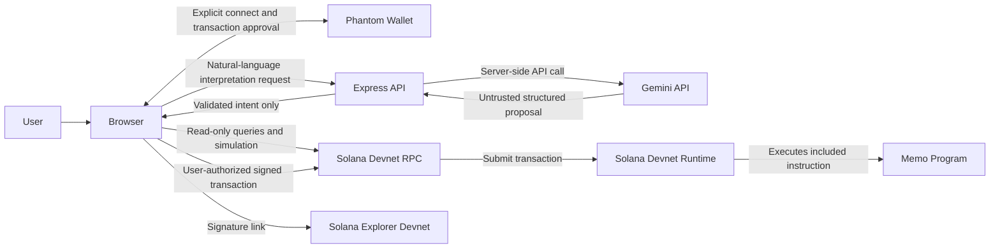

# SolGuard AI Architecture

## Status and scope

This document defines the intended architecture and module boundaries for the MVP. The current foundation includes a responsive, modular presentation-only frontend for the Command Center, AI Copilot, Wallet Scanner, Wallet X-Ray, Transaction History, and Settings; the Express health endpoint and request/error handling; an unmounted AI rate limiter; Ajv schema validation; shared intent validation; JSON Schema contracts; and tests for these boundaries. It does not implement AI interpretation, risk analysis, wallet access, blockchain reads, or transactions. UI values that require these integrations are explicitly unavailable.

The architecture follows the approved product requirements: Devnet only, deterministic validation of untrusted AI output, explicit Phantom authorization, and no fabricated chain data.

## System context



Gemini has no interface to Phantom, signing, transaction construction, simulation, or transaction execution. The only output crossing from the AI service toward transaction workflows is an untrusted intent proposal that must pass deterministic validation and user review.

## Four logical layers

### A. Frontend presentation — `frontend/`

Vanilla JavaScript ES modules, served and built by Vite. The current UI includes Command Center, AI Copilot, Wallet Scanner, Wallet X-Ray, Transaction History, and Settings screens. Transaction preview is integrated into the Command Center. These are presentation surfaces only; they do not call AI, wallet, or blockchain integrations.

Frontend responsibilities:

- Collect user input and show validated response states.
- Render exact transaction contents, data provenance, risk evidence, and limitations.
- Own browser-only Phantom provider discovery, connection, and explicit authorization prompts.
- Send a validated, fully reviewed transaction to Phantom only after explicit user action.
- Never receive or embed Gemini credentials.

### B. Backend API — `backend/src/`

Express application. Owns request parsing, API validation, error mapping, rate limiting, and server-side Gemini access. The browser never calls Gemini directly and never receives its credential.

The backend's interpret endpoint proposes intent only. It must not import or call blockchain transaction execution or Phantom modules.

### C. Blockchain integration — `blockchain/src/`

Devnet-only RPC configuration, read-only account inspection, transaction construction, simulation, and submission/confirmation primitives. Transaction construction uses validated contracts and supports either one recipient or an atomic batch of 2–5 recipients.

Phantom is a browser-injected provider; its manager belongs in `frontend/src/services/wallet/`, not in a Node-only backend package. Client-side transaction construction and wallet submission are orchestrated by frontend blockchain services against the blockchain boundaries. No server service can sign as the user.

### D. Security and validation — `shared/validation/`, `shared/schemas/`, and narrowly scoped boundary guards

JSON Schemas define closed data contracts under `shared/schemas/`. Canonical pure domain validation and exact amount conversion belong in `shared/validation/`; backend and blockchain boundaries call those same functions and add only transport- or transaction-specific checks. Deterministic semantic checks include canonical addresses, positive bounded amounts, Devnet network, supported operations, recipient constraints, exact totals, and transaction limits. Risk assessment must be explainable, evidence-based, and explicitly heuristic. Memo formatting is deterministic and visible before authorization.

This is a logical layer, not a second copy of business logic. Shared schemas define shape; canonical security-sensitive intent rules have one implementation and are called at each untrusted boundary.

## Data flow and trust boundaries

1. The browser sends the user's text to `POST /api/ai/interpret`.
2. The backend validates request size and shape, applies rate limiting, and calls the Gemini service using a server-side credential.
3. Gemini's response is treated as untrusted text/data. The intent parser decodes it; the deterministic intent validator rejects unsupported, malformed, ambiguous, or out-of-range values and converts decimal SOL values to integer lamports.
4. The backend returns a normalized intent proposal. It does not construct or sign a transaction.
5. The frontend displays the proposed intent and obtains user review. The browser-side Solana integration inspects recipients and creates a preview using Devnet RPC; security assessment explains available evidence.
6. The user reviews the exact instructions and explicitly invokes Phantom. Phantom displays the signing request and remains the authorization boundary.
7. Submission and confirmation results come from actual RPC/wallet outcomes. The frontend displays only observed results and a Devnet Explorer link.

## Module responsibilities and interfaces

These are architectural contracts, not implementations. Use dependency injection for network, clock, and Gemini client boundaries when implementation begins; do not add abstraction layers without a concrete testing or security need.

| Module | Responsibility | Intended interface |
|---|---|---|
| Gemini service | Server-side Gemini transport, model/configuration handling, bounded request/response, provider error normalization. No transaction imports. | `interpretPrompt({ prompt, model }) -> Promise<unknown>`; returns untrusted provider output. |
| Intent parser | Decode Gemini's response into the expected candidate shape; no trust implied. | `parseCandidate(providerOutput) -> IntentCandidate` or typed parse error. |
| Intent validator (`shared/validation/`) | Strict shape/semantic validation, reject ambiguous/unsupported intent, validate addresses and bounds, convert decimal SOL to canonical lamports. | `validateCandidate(candidate) -> TransactionIntent` or validation issues. |
| Solana connection manager | Create/reuse a read/write RPC connection explicitly configured for Devnet; fail closed for other clusters. | `getDevnetConnection() -> Connection`; no implicit Mainnet fallback. |
| Phantom wallet manager | Browser-only provider discovery, connect/disconnect, public-key/network checks, and wallet authorization request. Never handles key export or seed phrases. | `connect()`, `disconnect()`, `getPublicKey()`, and `requestAuthorization(unsignedTransaction, { userGesture })`. |
| Wallet inspection service | Query account state and other available RPC data; report source, observation time, and missing/partial data honestly. | `inspectWallet(address) -> WalletSecurityReport` with raw observed facts kept distinct from interpretation. |
| Risk assessment engine (`blockchain/src/security/`) | Apply deterministic, documented heuristics to observed evidence; produce indicators and limitations, never safety guarantees. | `assessWallet(observedFacts) -> RiskAssessment`; unavailable inputs yield unavailable assessment, not invented evidence. |
| Transaction builder | Build only supported SOL transfer and optional memo instructions from a validated intent and explicit payer/network. | `buildTransaction(intent, payer, memoChoice) -> TransactionPreview + unsigned transaction`; never signs. |
| Transaction simulator | Simulate the unsigned transaction against Devnet and translate actual RPC response into preview status. | `simulate(unsignedTransaction) -> SimulationResult`; unavailable/error is not success. |
| Transaction execution service | After explicit user action, orchestrate Phantom authorization/submission and observe RPC confirmation. No autonomous path. | `executeWithWallet(unsignedTransaction, userGesture) -> TransactionResult`; asks the Phantom manager to authorize. |
| Memo builder | Deterministically validate/format an optional, user-reviewed public memo; reject sensitive/unnecessary content per product rules. | `buildMemo(explicitUserApprovedText) -> MemoInstructionData`. |
| Wallet X-Ray service (`frontend/src/services/blockchain/wallet-xray/`) | Compose read-only address validation, RPC inspection, and heuristic assessment for arbitrary public addresses on Devnet. | `inspectAddress(address) -> WalletSecurityReport`; no transaction or signing capability. |

### Non-bypassable capability boundary

- The Gemini service and intent parser return proposal data only; they cannot import Phantom, the transaction builder, or the execution service.
- The backend interpret route returns `TransactionIntent` only; no serialized transaction or sign/execute command is part of that response.
- Only the browser's explicit user action can trigger Phantom authorization.
- Transaction construction consumes validated intent; risk assessment cannot add, remove, or rewrite recipients or amounts.
- A simulation result is informative, not authorization or a guarantee of success.

## Folder responsibilities

```text
frontend/
  assets/                  Static images and icons; no credentials.
  src/config/              Public, non-secret frontend configuration.
  src/components/          Reusable presentation components.
  src/pages/               Requirement-driven page composition.
  src/services/api/        Same-origin calls to the SolGuard backend.
  src/services/wallet/     Browser-only Phantom provider manager.
  src/services/blockchain/ Browser-side calls for previews, wallet transactions, and read-only Wallet X-Ray composition.
  src/utils/               UI-only pure utilities; no duplicated server policy.
  src/styles/              Vite-imported main and component CSS.
  src/pages/{dashboard,copilot,security-scanner,wallet-xray,transaction-preview,transaction-history}/
                           Requirement-driven page areas; placeholders only.
backend/src/
  controllers/             HTTP request/response orchestration.
  middleware/              Request limits, rate limiting, and API error handling.
  routes/                  Express route registration.
  security/                Backend-owned API security policy.
  services/gemini/         Server-only Gemini client.
  services/intent/         Parsing and validated intent orchestration.
  validators/              HTTP parsing/size/transport checks; delegates domain invariants.
  utils/                   Backend-only small utilities.
blockchain/src/
  config/                  Devnet-only cluster configuration.
  inspection/              RPC-based wallet observation.
  security/                Heuristic risk assessment and transaction-specific invariant checks.
  memo/                    Memo data/instruction construction.
  rpc/                     Connection and low-level RPC boundaries.
  transactions/             Build, simulate, submit, and confirm primitives (single or 2–5 recipient batch).
shared/schemas/             Versioned cross-layer JSON Schema contracts.
shared/validation/          Canonical pure domain validation and amount conversion.
tests/
  unit/                     Pure module and contract tests.
  validation/               Malformed, boundary, and adversarial input cases.
  backend/                  HTTP contract and error-path tests.
  blockchain/               Devnet/local-validator integration boundary tests.
  fixtures/                 Sanitized deterministic test inputs; never fake live evidence.
```

## Structural decisions and deviations

- **Keep `frontend/src/` rather than the sample `frontend/js/` and `frontend/css/`:** Vite's existing project uses its conventional `src` entry and CSS import. Keeping it avoids custom resolution and preserves the verified build; `src/styles/` provides the requested style separation.
- **Move the Express entry from `backend/server.js` to `backend/src/server.js`:** Aligns with the agreed source tree and gives application code a clear boundary.
- **Put Phantom in the frontend:** Phantom injects a browser provider and user-approval interface. Placing it in a server-side blockchain module would misrepresent its runtime and security boundary.
- **Keep Wallet X-Ray orchestration browser-side:** The requested initial API contract includes only health and AI interpretation. Read-only address inspection can compose the browser's Devnet RPC and assessment modules without inventing an additional backend endpoint.
- **Keep the local backend host configurable:** The current server defaults to loopback for local development. A conventional server host must explicitly bind to its externally reachable interface; serverless targets require a platform adapter and cannot use this listener as-is.
- **Keep security as a cross-cutting logical layer rather than a duplicated package:** Shared schemas and a single owner for each validator/policy avoid parallel implementations that can disagree.
- **Add `shared/validation/` alongside `shared/schemas/`:** Schema files describe shape but cannot alone enforce exact decimal-to-lamports conversion, decoded public keys, sums, and cross-field invariants. A shared pure-domain implementation avoids divergent backend and blockchain rules; transport-specific checks remain local to each boundary.
- **Use native Node test runner and JSON Schema files:** The current contract scaffold needs no additional dependencies. A schema validator can be selected when runtime schema validation is implemented; JSON Schema files alone do not constitute runtime validation.
- **Use placeholders for future modules:** Empty folders keep the agreed architecture navigable without implying that product functionality exists.

## Testing architecture

- **Unit (`tests/unit/`):** Pure parser, amount-to-lamports conversion, total calculation, memo formatting, and transaction boundary helpers. Deterministic clock/RPC/provider inputs are injected.
- **Validation (`tests/validation/`):** Missing/extra fields, malformed Base58 keys, ambiguous Gemini outputs, zero/negative/overprecision/overflow amounts, unsupported networks, duplicate recipients where disallowed, and oversized instructions. Assert rejection rather than normalization into a different transaction.
- **Risk scoring:** Table-driven tests map observed evidence to documented indicators. Test absent/partial RPC data and ensure no score implies guaranteed safety.
- **Backend API (`tests/backend/`):** Exercise status, request schema, size/rate limits, Gemini timeouts/provider failures, malformed model output, safe error envelopes, and absence of provider credentials in responses. Mock only the Gemini transport boundary, not a fake successful product response.
- **Blockchain integration (`tests/blockchain/`):** Unit-test instruction composition without sending. For integration, use Solana Devnet or a local test validator when one is deliberately introduced; use generated test keypairs and valueless test accounts only. No Mainnet and no real funds. Test simulation failure, RPC unavailable, wallet rejection, confirmation failure, and atomic multi-recipient instruction shape.
- **Fixtures (`tests/fixtures/`):** Store clearly labeled deterministic test inputs/recorded responses; never label fixture results as live chain data or ship them to the product UI.
- **Current foundation checks:** `npm test` uses the built-in Node test runner to exercise health/error handling, rate limiting, schema validation, intent semantic validation, and all seven JSON Schema contracts. No integration service is started by this test.

Blockchain integration tests must not require real funds. Any future Devnet test should use disposable test accounts and request only testnet tokens; ordinary test runs remain offline.
