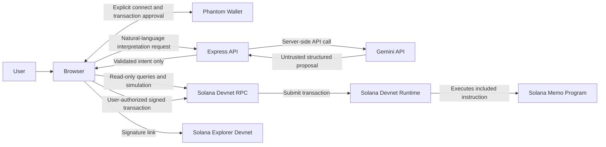

# SolGuard AI Architecture

## Status and scope

This document defines the intended architecture and module boundaries for the MVP. The current foundation includes a responsive frontend for the Command Center, AI Copilot, Wallet Scanner, Wallet X-Ray, Transaction History, and Settings; Phantom connection and live Devnet balance; Devnet wallet inspection and deterministic heuristic risk assessment; a rate-limited, server-side Gemini interpretation API with deterministic fallback; and explicit Phantom signing of simulated, atomic SOL transfers through the fixed Devnet RPC.

The architecture follows the approved product requirements: Devnet only, deterministic validation of untrusted AI output, explicit Phantom authorization, and no fabricated chain data. Wallet X-Ray uses the same evidence-based Devnet inspection as the recipient scanner. The transaction history view stores only in-memory attempts from the current page session; it uses no database or browser storage.

## System context



Gemini has no interface to Phantom, signing, transaction construction, simulation, or transaction execution. The only output crossing from the AI service toward transaction workflows is an untrusted intent proposal that must pass deterministic validation and user review.

## Four logical layers

### A. Frontend presentation — `frontend/`

Vanilla JavaScript ES modules, served and built by Vite. The current UI includes Command Center, AI Copilot, Wallet Scanner, Wallet X-Ray, Transaction History, and Settings screens. Transaction preview and explicit approval are integrated into the Copilot flow. Phantom provides public-key connection and signs only after the user reviews the prepared transaction.

Frontend responsibilities:

- Collect user input and show validated response states.
- Render exact transaction contents, data provenance, risk evidence, and limitations.
- Own browser-only Phantom provider discovery, connection, and explicit authorization prompts.
- Send a validated, fully reviewed transaction to Phantom only after explicit user action.
- Never receive or embed Gemini credentials.

### B. Backend API — `backend/src/`

Express application. Owns request parsing, API validation, error mapping, rate limiting, and server-side Gemini access. The browser never calls Gemini directly and never receives its credential.

The backend's interpret endpoint proposes intent only. It must not import or call blockchain transaction execution or Phantom modules.

### C. Blockchain integration — `blockchain/src/`

Devnet-only RPC configuration, balance/account/signature inspection, deterministic heuristic assessment, transaction construction, simulation, and submission/confirmation are implemented. Transaction construction validates the intent and supports one to five recipients in one atomic transfer transaction.

Phantom is a browser-injected provider; its manager belongs in `frontend/src/services/wallet/`, not in a Node-only backend package. Client-side transaction construction and wallet submission are orchestrated by frontend blockchain services against the blockchain boundaries. No server service can sign as the user.

### D. Security and validation — `shared/validation/`, `shared/schemas/`, and narrowly scoped boundary guards

JSON Schemas define closed data contracts under `shared/schemas/`. Canonical pure domain validation and exact amount conversion belong in `shared/validation/`; backend and blockchain boundaries call those same functions and add only transport- or transaction-specific checks. Deterministic semantic checks include canonical addresses, positive bounded amounts, Devnet network, supported operations, recipient constraints, exact totals, and transaction limits. Risk assessment must be explainable, evidence-based, and explicitly heuristic. Memo formatting is deterministic and visible before authorization.

This is a logical layer, not a second copy of business logic. Shared schemas define shape; canonical security-sensitive intent rules have one implementation and are called at each untrusted boundary.

## Data flow and trust boundaries

1. The browser sends the user's text to `POST /api/ai/interpret`.
2. The backend validates request size and shape, applies rate limiting, and calls Gemini using a server-side credential; if unavailable, it may use the constrained deterministic fallback.
3. Gemini's response is treated as untrusted data. The closed candidate schema and deterministic validator reject unsupported, malformed, ambiguous, ungrounded, or out-of-range values and convert decimal SOL values to integer lamports.
4. The backend returns either a normalized proposal or a clarification/unsupported status. It does not construct or sign a transaction.
5. The frontend displays the proposed intent, scans every recipient through Devnet RPC, validates account destinations, estimates fee and balance, then simulates the complete transaction before rendering the confirmation.
6. Only after explicit user approval does Phantom sign the exact reviewed message. The browser verifies the message, submits signed bytes to fixed Devnet RPC, and reports observed confirmation/Explorer proof. Gemini cannot initiate these capabilities.
7. Submission and confirmation results come from actual RPC/wallet outcomes. The frontend displays only observed results and a Devnet Explorer link.

## Module responsibilities and interfaces

The interfaces below describe current and planned module boundaries. Use dependency injection for external network and Gemini boundaries; do not add abstraction layers without a concrete testing or security need.

| Module | Responsibility | Intended interface |
|---|---|---|
| Gemini service (`backend/src/services/gemini/`) | Server-only Gemini 2.5 Flash transport, bounded request/response, schema-constrained output, and a disclosed deterministic fallback. No transaction imports. | `interpretNaturalLanguage(prompt) -> InterpretationResult`; returns only a validated proposal or clarification. |
| Intent parser/validator (`backend/src/validators/`) | Parse the closed interpretation candidate, require addresses and explicit amounts to be present in the prompt, enforce equal split and total arithmetic, validate addresses and bounds, convert decimal SOL to canonical lamports. | `validateIntentCandidate(candidate) -> TransactionIntent` or validation issues. |
| Solana connection manager | Create/reuse a read/write RPC connection explicitly configured for Devnet; fail closed for other clusters. | `getDevnetConnection() -> Connection`; no implicit Mainnet fallback. |
| Phantom wallet manager (`frontend/src/services/wallet/phantom-wallet.js`) | Browser-only provider discovery, connect/disconnect, public-key state, and account-bound signing on explicit call. Never handles key export or seed phrases. | `connect()`, `disconnect()`, and `signTransaction(transaction, expectedAddress)`; caller invokes signing only in a user approval flow. |
| Wallet inspection service (`blockchain/src/inspection/`) | Concurrently query Devnet balance, account info, and up to 20 recent signatures; normalize account types and partial failures. | `inspectWalletSecurity(address) -> WalletSecurityReport` with observed RPC facts separate from score interpretation. |
| Risk assessment engine (`blockchain/src/security/`) | Produce a deterministic 0–100 observed-risk heuristic, factors, missing information, and recommended action. Neutral metadata alone scores zero; failed/missing core RPC data is unknown. | `assessWalletRisk(observation) -> RiskAssessment`; no AI inputs or safety guarantees. |
| Transaction builder (`blockchain/src/transactions/transaction-builder.js`) | Validate strict Devnet intent, account destinations, exact lamports, current balance/fee; build all transfers and compact heuristic memo in one legacy transaction; simulate before review. | `prepareSolTransferTransaction({ intent, payerAddress, riskSummary }) -> { preview, transaction }`; never signs. |
| Transaction risk summary (`blockchain/src/security/transaction-risk.js`) | Summarize every scanned recipient using the highest observed category/score; unavailable evidence blocks preparation, high/critical remains explicit. | `summarizeTransactionRisk(reports) -> TransactionRiskSummary`. |
| Transaction execution service (`blockchain/src/transactions/transaction-executor.js`) | Recheck blockhash, balance, and simulation; request a Phantom signature after explicit UI action; verify message immutability; submit only to fixed Devnet RPC; report confirmation and attempt parsed on-chain memo verification. | `executePreparedTransfer(prepared, { signTransaction }) -> TransactionResult`; no automatic invocation. Memo verification may be unavailable independently of transaction confirmation. |
| Audit memo builder (transaction builder) | Produce a short SolGuard-generated heuristic record without natural-language descriptions or wallet metadata. | `SOLGUARD_V1 | OBSERVED_RISK: <CATEGORY> <SCORE>/100 | HEURISTIC`; not an independent certification. |
| Wallet X-Ray (`frontend/src/pages/xray.js`, `blockchain/src/inspection/wallet-security.js`) | Read-only arbitrary-address inspection: balance, account info, recent signatures, risk factors, missing information, and suggested precautions. Never infers complete history or identity. | `inspectWalletSecurity(address) -> WalletSecurityReport`; no transaction or signing capability. |
| Session transaction history (`frontend/src/services/blockchain/session-transaction-history.js`) | Keep attempts initiated through the current application page in volatile memory and display only observed signatures/statuses. | `recordSessionTransaction(preview, riskSummary)` and `updateSessionTransaction(id, result)`; no local/session storage or server persistence. |

### Non-bypassable capability boundary

- The Gemini service and intent parser return proposal data only; they cannot import Phantom, the transaction builder, or the execution service.
- The backend interpret route returns a normalized intent proposal or clarification; no serialized transaction or sign/execute command is part of that response.
- Only the browser's explicit user action can trigger Phantom authorization.
- Transaction construction consumes validated intent; risk assessment cannot add, remove, or rewrite recipients or amounts. Recipient transfers and audit memo are instructions in one atomic transaction.
- A simulation result is informative, not authorization or a guarantee of success.

## Folder responsibilities

```text
frontend/
  src/app.js, main.js      Client composition, route events, and Vite entry point.
  src/components/          Activity table, copilot, intent, inspection, and confirmation UI.
  src/pages/               Dashboard, Copilot, Scanner, X-Ray, History, and Settings screens.
  src/services/wallet/     Browser-only Phantom provider connection and signing.
  src/services/blockchain/ Balance, volatile session history, and browser-side helpers.
  src/styles/              Vite-imported main and component CSS.
backend/src/
  app.js, server.js         Express application and local HTTP entry point.
  middleware/               AI interpretation rate limiting.
  routes/                   Health and AI interpretation endpoints.
  services/gemini/          Server-only Gemini transport and deterministic fallback.
  validators/               Request, schema, and intent validation.
blockchain/src/
  config/, rpc/              Fixed Devnet connection and commitment.
  inspection/                RPC-based wallet observation.
  security/                  Heuristic assessment and transaction risk summary.
  transactions/              Build, simulate, sign-boundary, submit, and confirm.
shared/schemas/               Cross-layer JSON Schema contracts.
shared/validation/            Canonical pure domain validation and amount conversion.
tests/
  unit/                       Domain, wallet, transaction, UI-rendering, and schema tests.
  backend/                    HTTP contract, health, and API failure tests.
```

## Structural decisions and deviations

- **Keep `frontend/src/` rather than the sample `frontend/js/` and `frontend/css/`:** Vite's existing project uses its conventional `src` entry and CSS import. Keeping it avoids custom resolution and preserves the verified build; `src/styles/` provides the requested style separation.
- **Move the Express entry from `backend/server.js` to `backend/src/server.js`:** Aligns with the agreed source tree and gives application code a clear boundary.
- **Put Phantom in the frontend:** Phantom injects a browser provider and user-approval interface. Placing it in a server-side blockchain module would misrepresent its runtime and security boundary.
- **Keep Wallet X-Ray orchestration browser-side:** The requested initial API contract includes only health and AI interpretation. Read-only address inspection can compose the browser's Devnet RPC and assessment modules without inventing an additional backend endpoint.
- **Keep the local backend host configurable:** The current server defaults to loopback for local development. A conventional server host must explicitly bind to its externally reachable interface; serverless targets require a platform adapter and cannot use this listener as-is.
- **Keep security as a cross-cutting logical layer rather than a duplicated package:** Shared schemas and a single owner for each validator/policy avoid parallel implementations that can disagree.
- **Add `shared/validation/` alongside `shared/schemas/`:** Schema files describe shape but cannot alone enforce exact decimal-to-lamports conversion, decoded public keys, sums, and cross-field invariants. A shared pure-domain implementation avoids divergent backend and blockchain rules; transport-specific checks remain local to each boundary.
- **Use native Node test runner and JSON Schema files:** The current contract scaffold needs no additional dependencies. A schema validator can be selected when runtime schema validation is implemented; JSON Schema files alone do not constitute runtime validation.
- **Keep remaining scaffold directories:** `.gitkeep` files reserve planned subareas; current implemented modules are listed above and empty directories do not imply implemented behavior.

## Testing architecture

- **Unit (`tests/unit/`):** Pure parser, amount-to-lamports conversion, total calculation, memo formatting, and transaction boundary helpers. Deterministic clock/RPC/provider inputs are injected.
- **Validation (`tests/validation/`):** Missing/extra fields, malformed Base58 keys, ambiguous Gemini outputs, zero/negative/overprecision/overflow amounts, unsupported networks, duplicate recipients where disallowed, and oversized instructions. Assert rejection rather than normalization into a different transaction.
- **Risk scoring:** Table-driven tests map observed evidence to documented indicators. Test absent/partial RPC data and ensure no score implies guaranteed safety.
- **Backend API (`tests/backend/`):** Exercise status, request schema, size/rate limits, malformed model output, safe error envelopes, and absence of provider credentials in responses. Unit-test grounded Gemini proposals and fallback behavior by mocking only the provider transport boundary.
- **Blockchain integration (`tests/blockchain/`):** Unit-test instruction composition without sending. For integration, use Solana Devnet or a local test validator when one is deliberately introduced; use generated test keypairs and valueless test accounts only. No Mainnet and no real funds. Test simulation failure, RPC unavailable, wallet rejection, confirmation failure, and atomic multi-recipient instruction shape.
- **Fixtures (`tests/fixtures/`):** Store clearly labeled deterministic test inputs/recorded responses; never label fixture results as live chain data or ship them to the product UI.
- **Current foundation checks:** `npm test` uses the built-in Node test runner to exercise health/error handling, interpretation route validation, rate limiting, schema validation, exact candidate validation, grounded fallback behavior, intent semantics, and all eight JSON Schema contracts. No integration service is started by this test.

Blockchain integration tests must not require real funds. Any future Devnet test should use disposable test accounts and request only testnet tokens; ordinary test runs remain offline.
